[Read in English](README.md) · [Enunciado del reto (sin cambios)](../README.md)

<p align="center">
  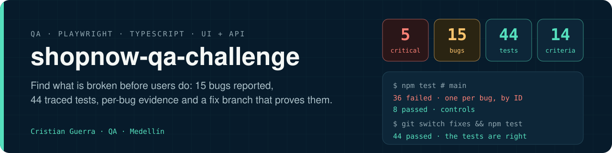
</p>

## Explicado como para un niño de 8 años

Imagina una tienda de juguetes pequeña donde metes juguetes en una canasta y pagas en la caja. Algunos niños dicen: "la cajera me dijo que mi plata no pasó… ¡pero igual me la quitaron!". Mi trabajo es visitar la tienda haciéndome pasar por un niño cuidadoso y por uno tramposo, probar cosas normales y cosas raras, y anotar con pruebas cada vez que la tienda se equivoca. Después armo un robotcito que repite cada truco todos los días: se pone **rojo** mientras el problema siga ahí y **verde** cuando alguien lo arregla.

### Un ejemplo real

- **Imagina que:** escribes el código de descuento en minúsculas, `flock10` en vez de `FLOCK10`.
- **Lo que debería pasar:** el spec dice que los códigos no distinguen mayúsculas, así que te dan 10 %: $28.70 queda en $25.83.
- **Lo que hace la tienda:** dice "Coupon flock10 applied (0%)" y cobra $28.70. Ese es el reporte de usuario 2.
- **Lo que hace el proyecto:** lo reporta como [BUG-06](../BUGS.md#bug-06--lowercase-coupon-codes-are-accepted-but-give-0-discount) con [video y log HTTP](../evidence/BUG-06/README.md), y cinco pruebas lo revisan por la API y por el carrito. Hoy fallan, y en la rama `fixes`, donde el bug está corregido, pasan.

<p align="center">
  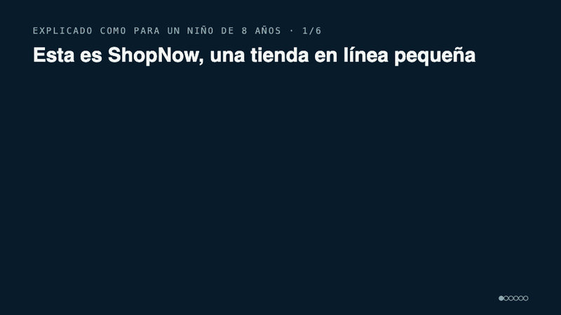
</p>

La misma animación en [MP4](../docs/assets/explained.es.mp4). La dibuja [`docs/scenes/explained.html`](../docs/scenes/explained.html) y se exporta con `npm run docs:animation`.

### Palabras difíciles

| Palabra | Qué significa |
|---|---|
| Bug | Algo que la tienda hace distinto a lo que prometió |
| Spec | La promesa de la tienda, por escrito ([`SPEC.md`](../SPEC.md)) |
| Oráculo | La hoja de respuestas: cuál es el resultado correcto, calculado desde el spec y no copiado de la tienda |
| Mutante | Una petición que funciona, con una sola cosa cambiada a propósito, para ver si la tienda se da cuenta |
| Page Object | Una chuleta de una pantalla: dónde está cada botón, para que las pruebas no lo repitan |
| Trazabilidad | Un hilo que une cada promesa con su prueba, su bug y su evidencia |
| Rojo / verde | La prueba falla porque el bug está / pasa porque lo arreglaron |
| CI | Un robot que corre todas las pruebas cada vez que alguien sube un cambio |

<div align="center">

# 🛒 ShopNow — Reto de QA (AI Verified)

**Encontrar lo que está roto antes que los usuarios y dejar pruebas que eviten que vuelva a pasar. Una entrega de QA hecha con [Playwright](https://playwright.dev/) + [TypeScript](https://www.typescriptlang.org/): análisis del spec, 15 bugs priorizados con evidencia, 44 pruebas UI + API trazadas, mutantes, una sonda de latencia, CI y una rama de fixes que prueba cada test.**

[](https://github.com/criguex/shopnow-qa-challenge/actions/workflows/qa.yml?query=branch%3Amain)
[](https://github.com/criguex/shopnow-qa-challenge/actions/workflows/qa.yml?query=branch%3Afixes)
[](https://playwright.dev/)
[](https://www.typescriptlang.org/)
[](https://nodejs.org/)
[-FB8176)](../BUGS.md)
[](../docs/TRACEABILITY.md)

</div>

> **El badge de `main` está en rojo a propósito.** `main` corre la app tal como la entregaron, así que las 36 pruebas que vigilan bugs abiertos fallan ahí. El badge de `fixes` corre las mismas pruebas contra la app con un fix por bug, y está en verde.

---

## 📑 Contenido

- [Resumen](#-resumen)
- [Cómo funciona](#-cómo-funciona)
- [Requisitos del reto y dónde están](#-requisitos-del-reto-y-dónde-están)
- [Bugs encontrados](#-bugs-encontrados)
- [Tipos de prueba](#-tipos-de-prueba)
- [Puntos destacados](#-puntos-destacados)
- [Arquitectura](#-arquitectura)
- [Estructura del proyecto](#-estructura-del-proyecto)
- [Principios de diseño](#-principios-de-diseño)
- [Estrategia de localizadores](#-estrategia-de-localizadores)
- [El oráculo](#-el-oráculo)
- [Escenarios mutantes](#-escenarios-mutantes)
- [Escenarios clave](#-escenarios-clave)
- [Trazabilidad](#-trazabilidad)
- [Evidencia](#-evidencia)
- [Rama de fixes](#-rama-de-fixes)
- [Rendimiento](#-rendimiento)
- [Cómo empezar](#-cómo-empezar)
- [Scripts disponibles](#-scripts-disponibles)
- [Configuración](#-configuración)
- [Reportes y artefactos](#-reportes-y-artefactos)
- [Integración continua](#-integración-continua)
- [Cómo se usó la IA](#-cómo-se-usó-la-ia)
- [Notas de entorno](#-notas-de-entorno)
- [Stack](#-stack)
- [Autor](#-autor)

---

## 🎯 Resumen

El reto: ShopNow es un e-commerce pequeño cuyo equipo entrega rápido con agentes de IA, y los bugs están llegando a producción. Hay que leer el spec y encontrarle los huecos, investigar tres reportes de usuarios, encontrar los bugs que nadie reportó y dejar pruebas Playwright que **fallen por esos bugs** y queden como regresión cuando los corrijan. Usar IA es obligatorio y se evalúa.

| Entregable | Resultado |
|---|---|
| Análisis del spec | [`ANALYSIS.md`](../ANALYSIS.md): 14 preguntas priorizadas para el PO, ambigüedades y supuestos |
| Bugs | [`BUGS.md`](../BUGS.md): **15 bugs**, 3 de reportes de usuarios + 12 encontrados por mí · 5 críticos, 5 altos, 3 medios, 2 bajos |
| Pruebas | [`tests/`](../tests): **44 pruebas Playwright** (26 API, 18 UI) sobre 14 criterios de aceptación · **36 fallan hoy**, una o más por bug, con el ID en el nombre · **8 de control pasan** |
| Prueba de las pruebas | rama [`fixes`](https://github.com/criguex/shopnow-qa-challenge/tree/fixes): un commit por bug → la misma suite queda **44/44 en verde** |
| Evidencia | [`evidence/BUG-XX/`](../evidence): pasos numerados, video con puntero, esperado vs. real, log HTTP, log del servidor |
| Trazabilidad | [`docs/TRACEABILITY.md`](../docs/TRACEABILITY.md): requisito → criterio → caso → bug → evidencia → resultado en las dos ramas |
| Uso de IA | [`ai/README.md`](../ai/README.md): herramientas, qué se delegó, qué se verificó y qué se descartó |
| Extras | presupuestos de latencia ([`perf/`](../perf)), CI ([`.github/workflows/qa.yml`](workflows/qa.yml)), estrategia a fondo ([`TESTING.md`](../TESTING.md)) |

---

## 🔭 Cómo funciona

<p align="center">
  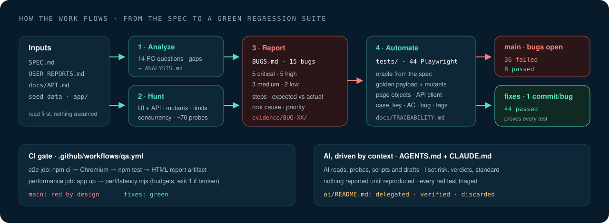
</p>

Primero leí todas las entradas (spec, reportes de usuarios, documentación de la API, datos semilla y el código de la app) y convertí los huecos del spec en preguntas y supuestos. Después cacé bugs por la UI y directo por la API, con valores límite, mutantes de peticiones válidas y compradores concurrentes. Cada sorpresa se reprodujo contra la app corriendo antes de volverse bug, con pasos, esperado vs. real, causa raíz, prioridad y evidencia. Luego cada bug recibió una o más pruebas cuyos valores esperados salen del spec, nunca de la app. En `main` esas pruebas están en rojo. En `fixes`, donde cada bug tiene su fix mínimo, todas pasan, y eso prueba que revisan lo correcto.

---

## ✅ Requisitos del reto y dónde están

| # | Requisito (de [`README.md`](../README.md)) | Dónde está |
|---|---|---|
| 1 | Preguntas para el PO, ambigüedades, supuestos | [`ANALYSIS.md`](../ANALYSIS.md) |
| 2 | Investigar los 3 reportes de usuarios | [BUG-01](../BUGS.md#bug-01--payments-over-100-are-reported-as-failed-but-the-customer-is-charged) (reporte 1) · [BUG-06](../BUGS.md#bug-06--lowercase-coupon-codes-are-accepted-but-give-0-discount) (reporte 2) · [BUG-08](../BUGS.md#bug-08--products-added-with-the-catalog-add-button-vanish-on-reload) (reporte 3) |
| 3 | Encontrar bugs que nadie reportó, por UI y API | [BUG-02…BUG-15](../BUGS.md) salvo 06 y 08 · sondas en [`ai/probes/`](../ai/probes) |
| 4 | Reportes reproducibles, clasificados y priorizados | [`BUGS.md`](../BUGS.md) (formato del reto) + [`evidence/`](../evidence) |
| 5 | Pruebas Playwright que fallen por los bugs | [`tests/`](../tests) · 36 en rojo en `main` |
| 6 | ID del bug en el nombre, `resetData` en `beforeEach`, `data-testid`, sin tocar `app/`, sin mocks, sin `test.fail/fixme/skip/only` | todos los specs de [`tests/`](../tests) · auditado, ver [Principios de diseño](#-principios-de-diseño) |
| 7 | Revisar las pruebas del equipo | [`tests/cart.spec.ts`](../tests/cart.spec.ts): la prueba original solo revisaba visibilidad; ahora afirma $16.70 |
| 8 | Cómo se usó la IA | [`ai/README.md`](../ai/README.md) + [`AGENTS.md`](../AGENTS.md) / [`CLAUDE.md`](../CLAUDE.md) |
| ➕ | Causa raíz en el código (opcional) | línea "Root cause" en cada bug de [`BUGS.md`](../BUGS.md) |
| ➕ | Fixes en commits separados con el ID (opcional) | rama [`fixes`](https://github.com/criguex/shopnow-qa-challenge/tree/fixes): 17 commits `fix(BUG-xx)` |
| ➕ | Otra herramienta, explicada en `TESTING.md` | [`perf/latency.mjs`](../perf/latency.mjs), [`evidence/record-evidence.mjs`](../evidence/record-evidence.mjs), [`TESTING.md`](../TESTING.md) |

---

## 🐞 Bugs encontrados

| ID | Bug | Origen | Severidad · Prioridad | Evidencia | Casos |
|---|---|---|---|---|---|
| BUG-01 | Pagos de más de $100 aparecen como fallidos pero sí cobran (y dos veces al reintentar) | Reporte 1 | Crítica · P1 | [ficha](../evidence/BUG-01/README.md) · video | PAY-01, PAY-02 |
| BUG-02 | Cualquier usuario logueado puede leer las órdenes de otros clientes | Yo | Crítica · P1 | [ficha](../evidence/BUG-02/README.md) · video | ORD-01, ORD-02 |
| BUG-03 | Una sola petición mal formada tumba toda la tienda | Yo | Crítica · P1 | [ficha](../evidence/BUG-03/README.md) · log del servidor | ROB-01, ROB-02 |
| BUG-04 | Acepta cantidades cero, negativas, decimales y no numéricas (pagos negativos "aprobados") | Yo | Crítica · P1 | [ficha](../evidence/BUG-04/README.md) · capturas | CHK-02…CHK-06 |
| BUG-05 | La API acepta varios cupones por compra, hasta dejar el total negativo | Yo | Crítica · P1 | [ficha](../evidence/BUG-05/README.md) · capturas | CPN-06…CPN-08 |
| BUG-06 | Los cupones en minúscula se aceptan pero dan 0 % | Reporte 2 | Alta · P1 | [ficha](../evidence/BUG-06/README.md) · video | CPN-01…CPN-05 |
| BUG-07 | El checkout nunca revisa el stock: sobreventa, stock negativo, carreras | Yo | Alta · P1 | [ficha](../evidence/BUG-07/README.md) · capturas | STK-01, STK-02 |
| BUG-08 | Lo que se agrega con el botón "Add" del catálogo desaparece al recargar | Reporte 3 | Alta · P2 | [ficha](../evidence/BUG-08/README.md) · video | CART-02, CART-03 |
| BUG-09 | Rechaza nombres y direcciones con tildes, ñ, ° o apóstrofes | Yo | Alta · P2 | [ficha](../evidence/BUG-09/README.md) · video | CHK-07…CHK-09 |
| BUG-10 | Los totales por línea se truncan: 3 × $8.35 = $25.04 | Yo | Media · P2 | [ficha](../evidence/BUG-10/README.md) · video | CART-04…CART-07 |
| BUG-11 | Después de recargar, el carrito deja acumular un segundo cupón | Yo | Alta · P2 | [ficha](../evidence/BUG-11/README.md) · video | CPN-09 |
| BUG-12 | Agregar dos veces desde la página del producto supera el stock | Yo | Media · P2 | [ficha](../evidence/BUG-12/README.md) · video | STK-03 |
| BUG-13 | Las órdenes hechas de noche muestran la fecha del día siguiente | Yo | Media · P2 | [ficha](../evidence/BUG-13/README.md) · video | ORD-03, ORD-04 |
| BUG-14 | Un JSON mal formado recibe una página HTML en vez de un error JSON | Yo | Baja · P3 | [ficha](../evidence/BUG-14/README.md) | CHK-10 |
| BUG-15 | Un `coupons` que no es lista se ignora en silencio | Yo | Baja · P3 | [ficha](../evidence/BUG-15/README.md) | CHK-11 |

La prioridad pone primero la plata, los datos personales y la disponibilidad. Lo que el spec no define (checkout idempotente, límite de intentos de login, largo de campos, redondeo de medio centavo) **no** se reporta como bug: son preguntas al PO en [`ANALYSIS.md`](../ANALYSIS.md) o sugerencias al final de [`BUGS.md`](../BUGS.md).

<table>
<tr>
<td width="50%"><br><sub><b>BUG-01</b> · "no se pudo procesar el pago", y cobra igual</sub></td>
<td width="50%">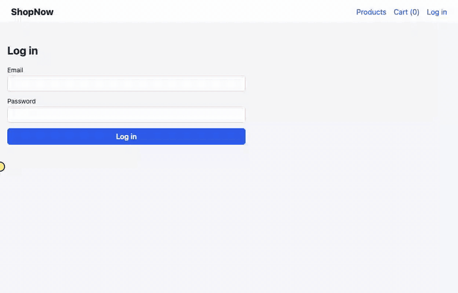<br><sub><b>BUG-02</b> · Ana abre la orden de Bruno cambiando la URL</sub></td>
</tr>
<tr>
<td width="50%">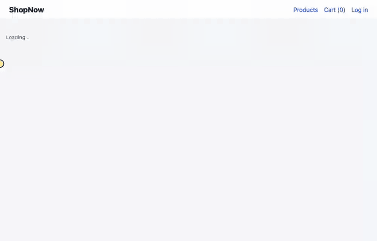<br><sub><b>BUG-06</b> · <code>flock10</code> aplicado con 0 %</sub></td>
<td width="50%">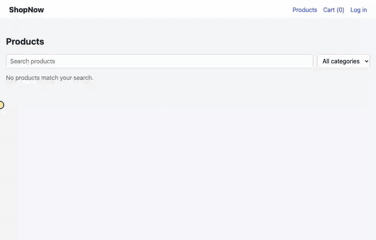<br><sub><b>BUG-08</b> · el "Add" del catálogo se pierde al recargar</sub></td>
</tr>
</table>

---

## 🗂️ Tipos de prueba

| Tipo | Qué valida | Comando | Pruebas | En CI |
|---|---|---|---|---|
| **API (reglas de negocio)** | Status codes, totales, descuentos, stock, órdenes y pagos creados, contrato JSON | `npm run test:api` | 26 | ✅ |
| **UI (recorridos del usuario)** | Carrito, cupones, checkout, órdenes y catálogo por las pantallas reales | `npm run test:browser` | 18 | ✅ |
| **Mutantes** | Un campo cambiado en un checkout o cupón válido → debe rechazarse | `npx playwright test --grep "@AC-05\|@AC-07"` | 10 | ✅ |
| **Concurrencia** | 3 compradores y 2 sillas al mismo tiempo → 2 compran, 1 recibe 409, el stock nunca queda negativo | `npx playwright test --grep @STK-02` | 1 | ✅ |
| **Robustez** | Payloads mal formados reciben 400 y el servidor sigue arriba | `npx playwright test --grep @BUG-03` | 2 | ✅ (corren de últimas) |
| **Controles** | Búsqueda y filtro, login, acceso, checkout válido, prueba del carrito del equipo | `npm run test:controls` | 8 | ✅ |
| **Por prioridad** | Plata, datos personales y disponibilidad primero | `npm run test:p1` | 22 | ✅ |
| **Rendimiento** | Presupuestos de latencia (p95 del catálogo, checkout vs. el timeout del cliente web) | `npm run perf` | 3 chequeos | ✅ job aparte |

Cualquier prueba también se puede correr por bug (`--grep @BUG-06`), por criterio (`--grep @AC-07`) o por caso (`--grep @CPN-05`).

---

## ✨ Puntos destacados

- **Primero los bugs que importan:** los cinco críticos son de plata, datos personales y disponibilidad, no cosméticos.
- **Los valores esperados salen del spec:** un [oráculo](#-el-oráculo) independiente, en centavos enteros y hora de Argentina, nunca copiado de lo que responde la app.
- **Mutantes de una petición válida:** un campo cambiado por prueba, con un control en verde que demuestra que la petición de partida es válida.
- **UI y API, cada una donde sirve:** recorridos por las pantallas, reglas por la API (más rápida y precisa).
- **Concurrencia:** una carrera real por las dos últimas sillas, con tres sesiones a la vez.
- **Todo trazado:** caso, criterio de aceptación, requisito, bug y tags; [matriz](../docs/TRACEABILITY.md) generada desde corridas reales.
- **Evidencia verificable:** pasos numerados, video con puntero visible, la falla en caja roja y el valor "real" leído en vivo de la app, más el log HTTP.
- **Pruebas comprobadas:** la rama [`fixes`](https://github.com/criguex/shopnow-qa-challenge/tree/fixes) pone en verde las 36 rojas, con un commit por bug.
- **IA guiada por contexto y verificada a mano:** un acuerdo de trabajo commiteado primero y un registro de qué se delegó, se verificó y se descartó.

---

## 🏗️ Arquitectura

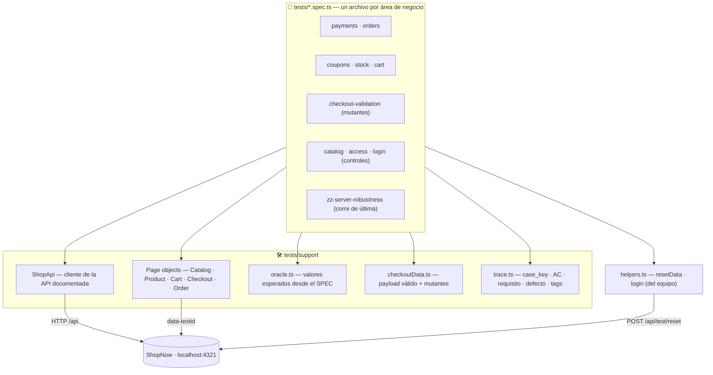

---

## 📁 Estructura del proyecto

```text
shopnow-qa-challenge/
├── README.md                     # Enunciado del reto (sin cambios)
├── ANALYSIS.md                   # Preguntas al PO, ambigüedades, supuestos
├── BUGS.md                       # 15 bugs priorizados, con evidencia y causa raíz
├── TESTING.md                    # Estrategia a fondo: riesgos, oráculo, mutantes, cobertura
├── AGENTS.md · CLAUDE.md         # Acuerdo de trabajo de la IA (primer commit)
├── ai/
│   ├── README.md                 # Uso de IA: delegado · verificado · descartado
│   └── probes/                   # ~70 sondas de API sobre las que se basan los reportes
├── tests/
│   ├── payments.spec.ts          # BUG-01
│   ├── orders.spec.ts            # BUG-02, BUG-13
│   ├── checkout-validation.spec.ts  # control + mutantes: BUG-04, 09, 14, 15
│   ├── coupons.spec.ts           # BUG-05, 06, 11
│   ├── stock.spec.ts             # BUG-07 (con compradores concurrentes), BUG-12
│   ├── cart.spec.ts              # prueba del equipo (reforzada), BUG-08, BUG-10
│   ├── catalog.spec.ts · access.spec.ts · login.spec.ts   # controles
│   ├── zz-server-robustness.spec.ts  # BUG-03, corre de última a propósito
│   ├── helpers.ts                # helpers del equipo: resetData, login
│   └── support/
│       ├── shopApi.ts            # cliente de la API (una instancia = una sesión)
│       ├── pages.ts              # page objects
│       ├── oracle.ts             # valores esperados desde el spec
│       ├── checkoutData.ts       # checkout válido + mutantes
│       └── trace.ts              # criterios de aceptación + metadatos de trazabilidad
├── evidence/
│   ├── record-evidence.mjs       # regenera toda la evidencia desde una app limpia
│   └── BUG-01 … BUG-15/          # ficha README · BUG-XX-NN.png · .mp4 · .gif · logs
├── docs/
│   ├── API.md                    # documentación de la API del reto (sin cambios)
│   ├── TRACEABILITY.md           # matriz generada
│   ├── assets/                   # banner, diagrama, animación explicativa
│   └── scenes/                   # fuente de la animación + exportador
├── perf/latency.mjs              # presupuestos de latencia (exit 1 si se rompen)
├── scripts/traceability.mjs      # arma docs/TRACEABILITY.md desde reportes JSON
├── .github/
│   ├── README.md · README.es.md  # esta página
│   └── workflows/qa.yml          # CI: e2e + rendimiento
└── app/                          # ShopNow (sin cambios en main; corregida en la rama fixes)
```

---

## 🧱 Principios de diseño

### Page Object Model + cliente de API

Cada pantalla es una clase pequeña que esconde el *cómo* detrás de métodos con intención (`quickAdd`, `applyCoupon`, `pay`). La API tiene su propio cliente, `ShopApi`, para probar las reglas de negocio por el contrato documentado sin pasar por la UI.

### SOLID, aplicado con criterio

| Principio | Cómo se ve aquí |
|---|---|
| **S** · responsabilidad única | `ShopApi` solo habla HTTP; cada page object es dueño de una pantalla; `oracle.ts` solo calcula esperados; `trace.ts` solo describe trazabilidad; los specs solo describen comportamiento. |
| **O** · abierto/cerrado | Un mutante nuevo es una entrada más en `QUANTITY_MUTANTS` / `MALFORMED_MUTANTS` o en una tabla de casos; no se toca código de prueba. |
| **L** · sustitución de Liskov | Cualquier `APIRequestContext` (el de la prueba o uno nuevo por comprador) sirve para un `ShopApi`; así corre la prueba concurrente con tres sesiones. |
| **I** · segregación de interfaces | Page objects pequeños, uno por pantalla, en vez de un "ShopNowPage" que lo sabe todo. |
| **D** · inversión de dependencias | Los specs dependen de `ShopApi` y de los page objects, no de URLs ni selectores; si cambia un selector, cambia una línea. |

### Convenciones

- **camelCase** para funciones y variables (`goldenCheckout`, `expectedTotals`), **PascalCase** para clases (`ShopApi`, `CartPage`), **MAYÚSCULAS** para datos fijos (`CATALOG`, `VALID_CARD`).
- **Arrange → Act → Assert** en cada prueba, con una sola acción bajo prueba.
- **Títulos en lenguaje de negocio**, con el ID del bug: `[BUG-07] three customers buying the last two units at once: only two succeed and stock never goes negative`.
- **TypeScript estricto** (`tsc --noEmit` limpio) y sin *parameter properties*, para que corra en Node 22 y 26.
- **Las reglas de pruebas del reto, auditadas antes de cada push:** `resetData` en `beforeEach`, localizadores `data-testid`, sin imports de `app/`, sin mocks, sin esperas fijas, sin `test.fail/fixme/skip/only` y `playwright.config.ts` intacto.

---

## 🎯 Estrategia de localizadores

Solo los `data-testid` de la app, como pide el reto. Nada de XPath ni CSS.

| Elemento | Localizador | Por qué |
|---|---|---|
| "Add" del catálogo | `getByTestId('quick-add-1')` | Estable por producto |
| Cantidad en la página del producto | `getByTestId('quantity-select')` | El control bajo prueba |
| Línea / total del carrito | `getByTestId('cart-line-total-1')` · `getByTestId('cart-total')` | Se afirman al centavo |
| Cupón | `getByTestId('coupon-input')` · `getByTestId('coupon-applied')` · `getByTestId('coupon-error')` | Se afirman la regla y el mensaje |
| Checkout | `getByTestId('shipping-name')` · `getByTestId('card-number')` · `getByTestId('pay-button')` | Recorrido completo de pago |
| Resultado | `getByTestId('order-success')` · `getByTestId('checkout-error')` | Lo que se le dice al cliente |
| Órdenes | `getByTestId('order-row-2')` · `getByTestId('order-date')` | Fecha en hora de Argentina |

---

## 🔮 El oráculo

Una aserción vale lo que vale su valor esperado. Aquí **nunca sale de lo que la app responde hoy**:

- [`oracle.ts`](../tests/support/oracle.ts) recalcula la plata desde el spec en **centavos enteros**: `expectedLineTotal(8.35, 3)` es `25.05` sin importar cómo haga la app sus cuentas en coma flotante.
- Las fechas se recalculan con `Intl` en `America/Argentina/Buenos_Aires` (`argentinaDate`), sin depender del formateador del servidor.
- Los status codes salen de [`docs/API.md`](../docs/API.md) (`400`, `401`, `402`, `409`); las reglas, de [`SPEC.md`](../SPEC.md) (un cupón, sin distinguir mayúsculas, mínimo 1, límite de stock).
- El oráculo nunca importa de `app/`: eso sería un espejo, no un oráculo.

Lo que se afirma siempre es un **resultado de negocio**: totales, descuentos, stock después de la acción, cuántas órdenes y pagos se crearon, status codes y el mensaje exacto que ve el cliente. "El elemento es visible" nunca es la aserción por sí sola.

---

## 🧬 Escenarios mutantes

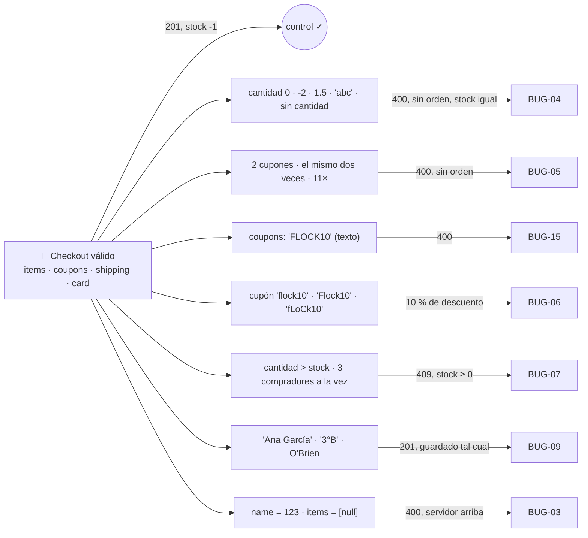

| Clase | Intención | Ejemplo | Esperado |
|---|---|---|---|
| `equivalent` | No debe cambiar el resultado | `flock10`, `Flock10` en vez de `FLOCK10` | el mismo 10 % |
| `boundary` | Borde que debe seguir funcionando, o debe frenarse | cantidad `0`, stock + 1, 3 × $8.35 | `400` / `409` / `$25.05` |
| `negative` | Debe rechazarse | cantidad `-2`, `"abc"`, 11 cupones | `400`, no se crea nada |
| `type` | Tipo JSON equivocado | `shipping.name: 123`, `items: [null]`, `coupons: "FLOCK10"` | `400`, el servidor sigue arriba |
| `real-world data` | Dato válido que la app olvidó | `Ana García`, `Av. Corrientes 1234, 3°B`, `O'Brien` | `201`, guardado tal cual |

Un mutante cambia **una sola** cosa de una petición que se sabe que funciona. Si el sistema acepta un mutante que debería rechazar, o se cae, eso es un hallazgo. La prueba de control demuestra que la petición de partida está en verde, así que un mutante en rojo significa que la regla está rota, no la prueba.

---

## 🧪 Escenarios clave

### BUG-01 · Por qué pasa el reporte de usuario 1

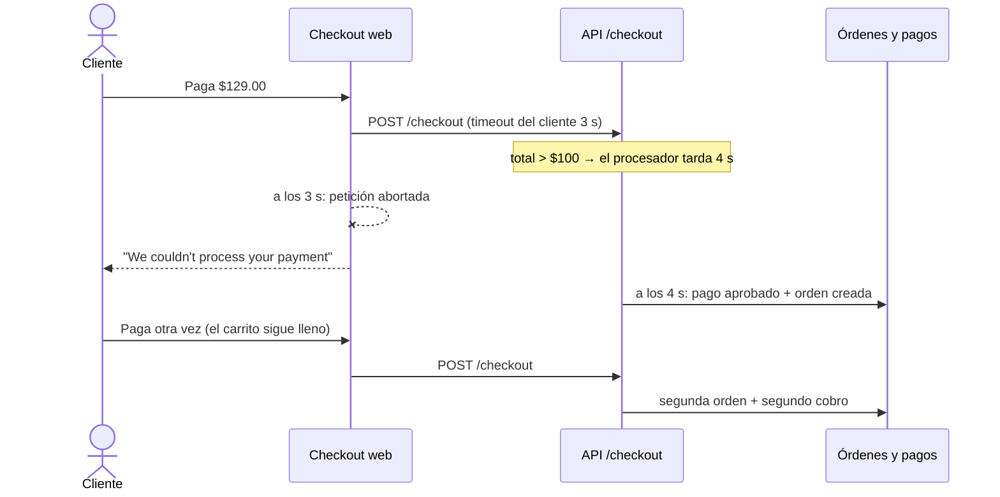

La prueba hace login, compra la silla de $129 con una tarjeta válida y afirma la **confirmación de la orden** y **exactamente un pago de $129.00**. Una segunda prueba afirma que una tarjeta rechazada por más de $100 diga *"The payment was declined by the bank."*

### BUG-07 · Tres clientes, dos sillas

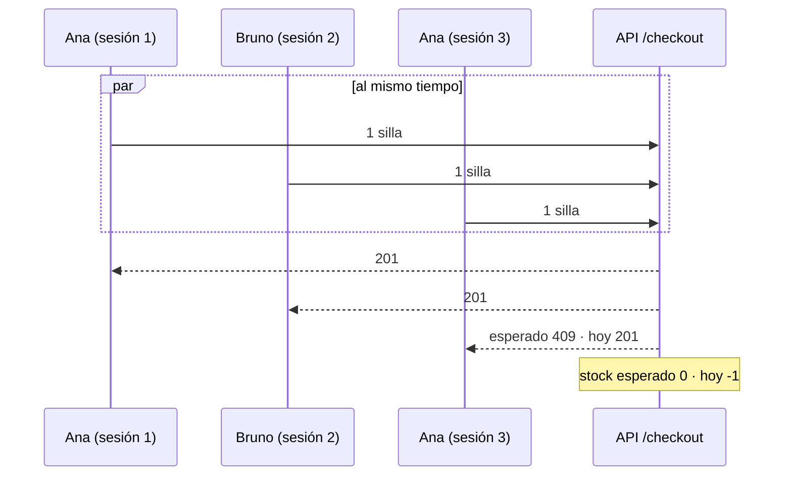

---

## 🧵 Trazabilidad

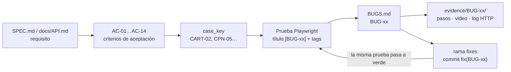

- **En el código:** [`trace.ts`](../tests/support/trace.ts) define los 14 criterios de aceptación y le da a cada prueba sus anotaciones `case_key`, `ac`, `requirement` y `defect`, más tags: capa `@api`/`@ui`, prioridad `@P1`–`@P3`, `@AC-xx`, `@BUG-xx` y el case key. Las anotaciones aparecen en el reporte HTML.
- **Matriz:** [`docs/TRACEABILITY.md`](../docs/TRACEABILITY.md) la genera `npm run traceability` desde los reportes JSON de `main` y `fixes`: cobertura por criterio y, por caso, su requisito, bug, evidencia y resultado en cada rama.
- **En los reportes:** cada bug de [`BUGS.md`](../BUGS.md) lista su carpeta de evidencia, la URL del recurso, los casos, los criterios y el commit del fix.
- **En git:** commits pequeños, uno por paso, en `main`; un commit `fix(BUG-xx)` por bug en `fixes`.

| Criterio | Pruebas | Bugs |
|---|---|---|
| AC-01 Búsqueda y filtro | 3 | — |
| AC-02 Agregar desde catálogo y desde el producto | 2 | BUG-08 |
| AC-03 No comprar más que el stock | 3 | BUG-07, BUG-12 |
| AC-04 Totales exactos al centavo | 5 | BUG-10 |
| AC-05 Cantidades enteras, mínimo 1 | 5 | BUG-04 |
| AC-06 El carrito persiste | 2 | BUG-08 |
| AC-07 Un cupón por compra | 5 | BUG-05, BUG-11, BUG-15 |
| AC-08 Códigos sin distinguir mayúsculas | 5 | BUG-06 |
| AC-09 Descuento = % del subtotal | 2 | BUG-06 |
| AC-10 Login antes de pagar | 3 | — |
| AC-11 El resultado del checkout es el real | 6 | BUG-01, BUG-09 |
| AC-12 Solo tus propias órdenes | 3 | BUG-02 |
| AC-13 Hora de Argentina | 2 | BUG-13 |
| AC-14 Contrato de la API y disponibilidad | 14 | BUG-03, 04, 05, 07, 14, 15 |

---

## 📸 Evidencia

Cada bug tiene su carpeta `evidence/BUG-XX/`, y su `README.md` es la ficha de evidencia del defecto:

- **Ambiente:** versión de la app, navegador, zona horaria, datos, usuarios, hora de grabación y un link al recurso.
- **Esperado vs. real:** el valor "real" se **lee en vivo de la app** mientras se graba, no se escribe a mano.
- **Bugs de UI:** capturas numeradas por paso (`BUG-XX-01.png`, `-02`…) y un video con el puntero visible, un banner que describe cada paso y la falla en caja roja con esperado vs. real (MP4 + GIF).
- **Bugs de API:** el log HTTP de cada llamada (método, ruta, status, cuerpos de petición y respuesta), más capturas de lo que el cliente ve después. BUG-04, por ejemplo, muestra un pago "aprobado" de -$28.70 y la página My payments en blanco.
- **BUG-03:** el log real del servidor cuando se cae.

`npm run evidence` la regenera toda desde una app limpia, así que la evidencia es reproducible y no está hecha a mano.

---

## 🩹 Rama de fixes

Una prueba en rojo solo demuestra algo si se pone verde cuando se corrige el bug. La extensión opcional vive en la rama [`fixes`](https://github.com/criguex/shopnow-qa-challenge/tree/fixes), aparte, para que `main` siga mostrando los bugs:

- un commit mínimo por bug, `fix(BUG-xx): …`, que apunta a la causa raíz escrita en `BUGS.md`;
- las mismas 44 pruebas: **36 en rojo en `main` → 44/44 en verde en `fixes`**, en local y en CI;
- el presupuesto de latencia sigue al nuevo timeout del cliente, así que ahí el job de rendimiento también queda en verde.

```bash
git switch fixes && npm test     # 44 passed
```

---

## 📈 Rendimiento

[`perf/latency.mjs`](../perf/latency.mjs) es Node puro (sin dependencias extra) y revisa dos presupuestos:

| Chequeo | Presupuesto | Medido en `main` |
|---|---|---|
| `GET /products` p95, 30 peticiones concurrentes | 200 ms | ~9 ms ✅ |
| `POST /checkout`, total ≤ $100 | 3.000 ms (timeout del cliente web) | ~0,7 s ✅ |
| `POST /checkout`, total > $100 | 3.000 ms | **~4,0 s ❌**: la raíz de BUG-01 |

Sale con código 1 si se rompe un presupuesto, para que el CI pueda frenar con él. Es una sonda, no una prueba de carga: un solo proceso local con un archivo JSON como base de datos daría números de estrés sin sentido.

---

## 🚀 Cómo empezar

### Requisitos

- **Node.js 22** (`.nvmrc`) y git. Node 26 también funciona; ver [Notas de entorno](#-notas-de-entorno).

### Instalar y correr

```bash
git clone https://github.com/criguex/shopnow-qa-challenge.git
cd shopnow-qa-challenge
npm install            # también instala Chromium
npm test               # la suite completa; levanta la app si no está corriendo
```

Salida esperada en `main` (bugs abiertos):

```text
Running 44 tests using 1 worker
  ✓  access.spec.ts › a guest who goes to checkout is asked to log in and returns to checkout
  ✓  access.spec.ts › the API refuses checkout, orders and payments without a session
  ✓  cart.spec.ts › the cart total is calculated correctly
  ✘  cart.spec.ts › [BUG-08] a product added with the catalog Add button is still in the cart after reloading
  ✘  cart.spec.ts › [BUG-10] cart shows 3 × $8.35 = $25.05
  …
  36 failed
  8 passed
```

Cada falla dice por qué, en términos de negocio:

```text
[BUG-10] cart shows 3 × $8.35 = $25.05          Expected string: "$25.05"  Received string: "$25.04"
[BUG-06] validating "flock10" returns …          Expected: 10               Received: 0
[BUG-07] checkout rejects a quantity above …     Expected: 409              Received: 201
[BUG-13] the API shows the order date …          Expected: "10/14/2026"     Received: "10/15/2026"
```

Y en la rama de fixes:

```bash
git switch fixes && npm test      # 44 passed
```

---

## 🧰 Scripts disponibles

| Script | Descripción |
|---|---|
| `npm test` | Suite completa (44 pruebas) |
| `npm run test:api` | Solo API (`@api`, 26) |
| `npm run test:browser` | Solo UI (`@ui`, 18) |
| `npm run test:p1` | Solo prioridad 1 (`@P1`, 22; `@P2` tiene 17 y `@P3`, 5) |
| `npm run test:controls` | Los 8 controles que deben pasar hoy |
| `npx playwright test --grep @BUG-06` | Un bug (también `@AC-07`, `@CPN-05`, `@P2`…) |
| `npm run test:ui` | Modo UI de Playwright |
| `npm run report` | Abre el último reporte HTML (con trazas de las fallas) |
| `npm run typecheck` | `tsc --noEmit` |
| `npm run perf` | Presupuestos de latencia (app corriendo) |
| `npm run evidence` | Vuelve a grabar la evidencia de todos los bugs (app limpia) |
| `npm run traceability -- <main.json> [fixes.json]` | Regenera `docs/TRACEABILITY.md` desde reportes JSON |
| `npm run docs:animation` | Vuelve a exportar el GIF/MP4 explicativo |
| `npm run dev` / `npm run reset` | Levanta la app / reinicia sus datos (scripts del reto) |

---

## ⚙️ Configuración

[`playwright.config.ts`](../playwright.config.ts) es el del reto y **no se modificó**: URL base `http://localhost:4321`, un worker, sin reintentos, Chromium, `en-US`, zona horaria `America/Argentina/Buenos_Aires`, traza guardada en las fallas y el servidor web levantado por la suite cuando hace falta.

- **Un worker a propósito:** cada prueba reinicia los datos compartidos, así que corren una detrás de otra.
- **Datos de prueba:** los usuarios semilla `ana@shopnow.test` y `bruno@shopnow.test`; los precios y el stock del catálogo viven en el oráculo (`CATALOG`).
- **Timeouts:** las peticiones de checkout en `ShopApi` esperan hasta 15 s, porque el procesador simulado tarda hasta 4 s.

---

## 📊 Reportes y artefactos

- **Reporte HTML** → `playwright-report/` (`npm run report`), con las anotaciones `case_key`, `ac`, `requirement` y `defect` en cada prueba.
- **Trazas** → se guardan en cada prueba que falla (`trace: retain-on-failure`).
- **Matriz de trazabilidad** → [`docs/TRACEABILITY.md`](../docs/TRACEABILITY.md).
- **Evidencia** → [`evidence/BUG-XX/`](../evidence).
- **Artefacto de CI** → `playwright-report`, subido en cada corrida.

---

## 🤖 Integración continua

[`.github/workflows/qa.yml`](workflows/qa.yml) corre en cada push y pull request:

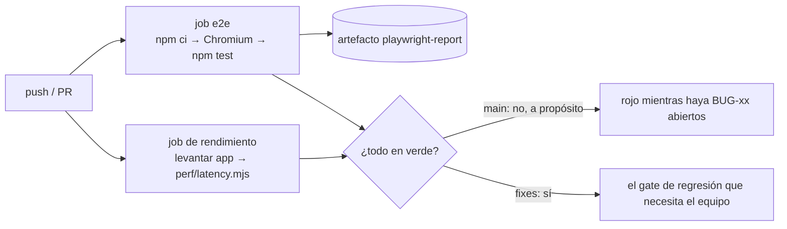

| Rama | e2e | rendimiento | Significado |
|---|---|---|---|
| `main` | ❌ 36 fallan · 8 pasan | ❌ el checkout > $100 tarda ~4 s | los bugs están ahí |
| `fixes` | ✅ 44 pasan | ✅ dentro del presupuesto | las mismas pruebas vigilan los fixes |

---

## 🧠 Cómo se usó la IA

El registro completo está en [`ai/README.md`](../ai/README.md). En resumen:

- **Primero el contexto:** [`AGENTS.md`](../AGENTS.md) (método, reglas de validación, reglas de pruebas del reto), cargado por [`CLAUDE.md`](../CLAUDE.md) y commiteado antes que todo lo demás.
- **Delegado a Claude Code (Claude Opus 5.5):** leer el código buscando sospechosos, ~70 sondas de API, la suite Playwright, el grabador de evidencia, el generador de trazabilidad y borradores de los documentos.
- **A mi cargo:** las decisiones de riesgo y prioridad, qué es bug y qué es pregunta, el estándar de evidencia y cada veredicto.
- **Verificado:** cada bug se reprodujo en vivo antes de reportarlo; cada prueba en rojo se revisó para confirmar que falla *por su bug*; la suite se comprobó al pasar a verde en `fixes`; la evidencia se revisó cuadro por cuadro.
- **Descartado o corregido:** un bug duplicado, comportamientos no definidos reportados como bugs, una regla `test.fail` que el reto prohíbe, una primera evidencia floja, links al puerto equivocado, un fix que rompió el chequeo de tipos y más, todo con su razón.

---

## 🧯 Notas de entorno

- **Node 26 + Playwright 1.48:** `npm install` descargó Chromium pero se quedó colgado al descomprimirlo. Se arregla descomprimiendo el archivo descargado en `~/Library/Caches/ms-playwright/chromium-1140`. Con Node 22 (el `.nvmrc` del repo) no pasa.
- **Node 26 y los tipos:** las *parameter properties* de TypeScript (`constructor(private page)`) rompen el loader de Playwright, así que las clases de soporte declaran sus campos de forma explícita.
- **Puerto 4321 ocupado:** `npm test` no puede levantar la app, y el puerto lo fija el reto. Hay que liberar el puerto, no cambiar la configuración.
- **BUG-03 tumba el servidor:** mientras siga abierto, las pruebas que lo provocan corren de últimas (ya está así), y hay que reiniciar la app después de `npm run evidence`.

---

## 🛠️ Stack

| Herramienta | Rol |
|---|---|
| [Playwright Test 1.48](https://playwright.dev/) | Runner, automatización del navegador, peticiones a la API, reportes, video |
| [TypeScript 5.6](https://www.typescriptlang.org/) | Tipado estricto de pruebas y soporte |
| `fetch` de Node.js | Sondas exploratorias y sonda de latencia, sin dependencias extra |
| [ffmpeg](https://ffmpeg.org/) | Evidencia en MP4/GIF y la animación explicativa |
| [GitHub Actions](https://github.com/features/actions) | CI: jobs de e2e y rendimiento |
| [Claude Code](https://www.anthropic.com/claude-code) | Agente de IA, guiado por `AGENTS.md` / `CLAUDE.md` |

---

## 👤 Autor

**Cristian Guerra**, QA Automation Engineer · [GitHub @criguex](https://github.com/criguex)

Hecho como entrega de un reto técnico.
