[Leer en español](README.es.md) · [Challenge statement (unchanged)](../README.md)

<p align="center">
  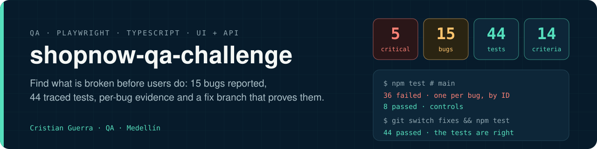
</p>

## Explained like you're 8

Imagine a small toy shop where you put toys in a basket and pay at the counter. Some kids say: "the cashier told me my money didn't go through… but it was taken anyway!". My job is to visit the shop pretending to be a careful kid and a sneaky kid, try normal things and weird things, and write down every time the shop gets it wrong, with proof. Then I build a little robot that repeats each trick every day: it shows **red** while the problem is there and turns **green** when someone fixes it.

### A real example

- **Imagine that:** you type the discount code in small letters, `flock10` instead of `FLOCK10`.
- **What should happen:** the spec says codes ignore capital letters, so you get 10% off: $28.70 becomes $25.83.
- **What the shop does:** it says "Coupon flock10 applied (0%)" and charges $28.70. That is user report 2.
- **What the project does:** reports it as [BUG-06](../BUGS.md#bug-06--lowercase-coupon-codes-are-accepted-but-give-0-discount) with a [video and the HTTP log](../evidence/BUG-06/README.md), and five tests check it through the API and the cart. They fail today, and they pass on the `fixes` branch, where the bug is fixed.

<p align="center">
  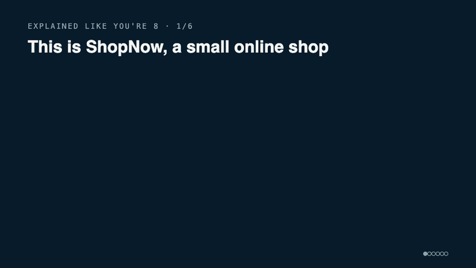
</p>

The same animation as [MP4](../docs/assets/explained.mp4). It is drawn by [`docs/scenes/explained.html`](../docs/scenes/explained.html) and exported with `npm run docs:animation`.

### Hard words

| Word | What it means |
|---|---|
| Bug | Something the shop does differently from what it promised |
| Spec | The shop's promise, written down ([`SPEC.md`](../SPEC.md)) |
| Oracle | The answer sheet: what the right result is, calculated from the spec, not copied from the shop |
| Mutant | A request that works, with one small thing changed on purpose, to see if the shop notices |
| Page Object | A cheat sheet for one screen: where each button is, so tests don't repeat it |
| Traceability | A thread from each promise to its test, its bug and its proof |
| Red / green | The test fails because the bug is there / passes because it was fixed |
| CI | A robot that runs every test each time someone uploads a change |

<div align="center">

# 🛒 ShopNow — QA Challenge (AI Verified)

**Find what is broken before users do, and leave tests that keep it from happening again. A QA delivery built with [Playwright](https://playwright.dev/) + [TypeScript](https://www.typescriptlang.org/): spec analysis, 15 prioritized bugs with evidence, 44 traced UI + API tests, mutants, a latency probe, CI and a fix branch that proves every test.**

[](https://github.com/criguex/shopnow-qa-challenge/actions/workflows/qa.yml?query=branch%3Amain)
[](https://github.com/criguex/shopnow-qa-challenge/actions/workflows/qa.yml?query=branch%3Afixes)
[](https://playwright.dev/)
[](https://www.typescriptlang.org/)
[](https://nodejs.org/)
[-FB8176)](../BUGS.md)
[](../docs/TRACEABILITY.md)

</div>

> **The `main` badge is red on purpose.** `main` runs the app exactly as delivered, so the 36 tests that guard open bugs fail there. The `fixes` badge runs the same tests against the app with one fix per bug, and it is green.

---

## 📑 Table of contents

- [Overview](#-overview)
- [How it works](#-how-it-works)
- [Challenge requirements → where they live](#-challenge-requirements--where-they-live)
- [Bugs found](#-bugs-found)
- [Test types](#-test-types)
- [Highlights](#-highlights)
- [Architecture](#-architecture)
- [Project structure](#-project-structure)
- [Design principles](#-design-principles)
- [Locator strategy](#-locator-strategy)
- [The oracle: where expected values come from](#-the-oracle-where-expected-values-come-from)
- [Mutant scenarios](#-mutant-scenarios)
- [Key scenarios](#-key-scenarios)
- [Traceability](#-traceability)
- [Evidence](#-evidence)
- [Fix branch: proof that the tests are right](#-fix-branch-proof-that-the-tests-are-right)
- [Performance](#-performance)
- [Getting started](#-getting-started)
- [Available scripts](#-available-scripts)
- [Configuration](#-configuration)
- [Reports & artifacts](#-reports--artifacts)
- [Continuous integration](#-continuous-integration)
- [How AI was used](#-how-ai-was-used)
- [Environment notes](#-environment-notes)
- [Tech stack](#-tech-stack)
- [Author](#-author)

---

## 🎯 Overview

The challenge: ShopNow is a small e-commerce site whose team ships fast with AI agents, and bugs are reaching production. Read the spec and spot its gaps, investigate three user reports, find the bugs nobody reported, and leave Playwright tests that **fail because of those bugs** and become regression tests once they are fixed. Using AI is mandatory and part of the evaluation.

| Deliverable | Result |
|---|---|
| Spec analysis | [`ANALYSIS.md`](../ANALYSIS.md): 14 prioritized PO questions, ambiguities and assumptions |
| Bugs | [`BUGS.md`](../BUGS.md): **15 bugs**, 3 user reports + 12 found by me · 5 Critical, 5 High, 3 Medium, 2 Low |
| Tests | [`tests/`](../tests): **44 Playwright tests** (26 API, 18 UI) across 14 acceptance criteria · **36 fail today**, one or more per bug, bug ID in the name · **8 controls pass** |
| Proof | branch [`fixes`](https://github.com/criguex/shopnow-qa-challenge/tree/fixes): one commit per bug → the same suite is **44/44 green** |
| Evidence | [`evidence/BUG-XX/`](../evidence): numbered steps, video with pointer, expected vs actual, HTTP log, server log |
| Traceability | [`docs/TRACEABILITY.md`](../docs/TRACEABILITY.md): requirement → criterion → case → bug → evidence → result on both branches |
| AI usage | [`ai/README.md`](../ai/README.md): tools, what was delegated, verified and discarded |
| Extras | latency budgets ([`perf/`](../perf)), CI ([`.github/workflows/qa.yml`](workflows/qa.yml)), strategy deep-dive ([`TESTING.md`](../TESTING.md)) |

---

## 🔭 How it works

<p align="center">
  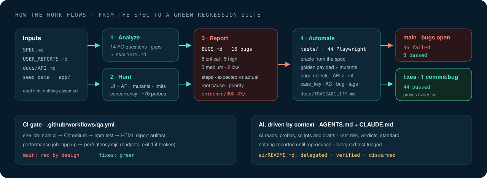
</p>

I read every input first (spec, user reports, API docs, seed data and the app code) and turned the spec's gaps into questions and assumptions. Then I hunted through the UI and straight through the API, with boundary values, mutants of valid requests and concurrent buyers. Every surprise was reproduced against the running app before it became a bug, with steps, expected vs actual, root cause, priority and evidence. Each bug then got one or more tests whose expected values come from the spec, never from the app. On `main` those tests are red. On `fixes`, where each bug has its own minimal fix, they are all green, which proves they test the right thing.

---

## ✅ Challenge requirements → where they live

| # | Requirement (from [`README.md`](../README.md)) | Where it lives |
|---|---|---|
| 1 | Questions for the PO, ambiguities, assumptions | [`ANALYSIS.md`](../ANALYSIS.md) |
| 2 | Investigate the 3 user reports | [BUG-01](../BUGS.md#bug-01--payments-over-100-are-reported-as-failed-but-the-customer-is-charged) (report 1) · [BUG-06](../BUGS.md#bug-06--lowercase-coupon-codes-are-accepted-but-give-0-discount) (report 2) · [BUG-08](../BUGS.md#bug-08--products-added-with-the-catalog-add-button-vanish-on-reload) (report 3) |
| 3 | Find bugs nobody reported, through UI and API | [BUG-02…BUG-15](../BUGS.md) except 06 and 08 · probes in [`ai/probes/`](../ai/probes) |
| 4 | Reproducible, classified, prioritized reports | [`BUGS.md`](../BUGS.md) (format from the challenge) + [`evidence/`](../evidence) |
| 5 | Playwright tests that fail because of the bugs | [`tests/`](../tests) · 36 red on `main` |
| 6 | Bug ID in the test name, `resetData` in `beforeEach`, `data-testid`, no `app/` access, no mocks, no `test.fail/fixme/skip/only` | every spec in [`tests/`](../tests) · audited, see [Design principles](#-design-principles) |
| 7 | Review the team's tests | [`tests/cart.spec.ts`](../tests/cart.spec.ts): the original test only checked visibility; it now asserts $16.70 |
| 8 | How AI was used | [`ai/README.md`](../ai/README.md) + [`AGENTS.md`](../AGENTS.md) / [`CLAUDE.md`](../CLAUDE.md) |
| ➕ | Root cause in the code (optional) | "Root cause" line in every bug of [`BUGS.md`](../BUGS.md) |
| ➕ | Fixes in separate commits with the bug ID (optional) | branch [`fixes`](https://github.com/criguex/shopnow-qa-challenge/tree/fixes): 17 `fix(BUG-xx)` commits |
| ➕ | Another tool, explained in `TESTING.md` | [`perf/latency.mjs`](../perf/latency.mjs), [`evidence/record-evidence.mjs`](../evidence/record-evidence.mjs), [`TESTING.md`](../TESTING.md) |

---

## 🐞 Bugs found

| ID | Bug | Source | Severity · Priority | Evidence | Test cases |
|---|---|---|---|---|---|
| BUG-01 | Payments over $100 are reported as failed but the customer is charged (twice on retry) | Report 1 | Critical · P1 | [sheet](../evidence/BUG-01/README.md) · video | PAY-01, PAY-02 |
| BUG-02 | Any logged-in user can read other customers' orders | Me | Critical · P1 | [sheet](../evidence/BUG-02/README.md) · video | ORD-01, ORD-02 |
| BUG-03 | One malformed checkout request takes the whole store down | Me | Critical · P1 | [sheet](../evidence/BUG-03/README.md) · server log | ROB-01, ROB-02 |
| BUG-04 | Zero, negative, decimal and non-numeric quantities accepted (negative "approved" payments) | Me | Critical · P1 | [sheet](../evidence/BUG-04/README.md) · screenshots | CHK-02…CHK-06 |
| BUG-05 | The API accepts several coupons per purchase, down to a negative total | Me | Critical · P1 | [sheet](../evidence/BUG-05/README.md) · screenshots | CPN-06…CPN-08 |
| BUG-06 | Lowercase coupon codes are accepted but give 0% | Report 2 | High · P1 | [sheet](../evidence/BUG-06/README.md) · video | CPN-01…CPN-05 |
| BUG-07 | Checkout never checks stock: overselling, negative stock, races | Me | High · P1 | [sheet](../evidence/BUG-07/README.md) · screenshots | STK-01, STK-02 |
| BUG-08 | Products added with the catalog "Add" button vanish on reload | Report 3 | High · P2 | [sheet](../evidence/BUG-08/README.md) · video | CART-02, CART-03 |
| BUG-09 | Names and addresses with accents, ñ, ° or apostrophes are rejected | Me | High · P2 | [sheet](../evidence/BUG-09/README.md) · video | CHK-07…CHK-09 |
| BUG-10 | Line totals are truncated: 3 × $8.35 = $25.04 | Me | Medium · P2 | [sheet](../evidence/BUG-10/README.md) · video | CART-04…CART-07 |
| BUG-11 | After a reload the cart lets the user stack a second coupon | Me | High · P2 | [sheet](../evidence/BUG-11/README.md) · video | CPN-09 |
| BUG-12 | Adding a product twice from its page exceeds the stock | Me | Medium · P2 | [sheet](../evidence/BUG-12/README.md) · video | STK-03 |
| BUG-13 | Late-night orders show the next day's date | Me | Medium · P2 | [sheet](../evidence/BUG-13/README.md) · video | ORD-03, ORD-04 |
| BUG-14 | Malformed JSON gets an HTML error page instead of JSON | Me | Low · P3 | [sheet](../evidence/BUG-14/README.md) | CHK-10 |
| BUG-15 | A `coupons` value that is not a list is silently ignored | Me | Low · P3 | [sheet](../evidence/BUG-15/README.md) | CHK-11 |

Priority puts money, personal data and availability first. Things the spec doesn't define (idempotent checkout, login rate limiting, field lengths, half-cent rounding) are **not** reported as bugs; they are PO questions in [`ANALYSIS.md`](../ANALYSIS.md) or suggestions at the end of [`BUGS.md`](../BUGS.md).

<table>
<tr>
<td width="50%"><br><sub><b>BUG-01</b> · "couldn't process your payment", charged anyway</sub></td>
<td width="50%">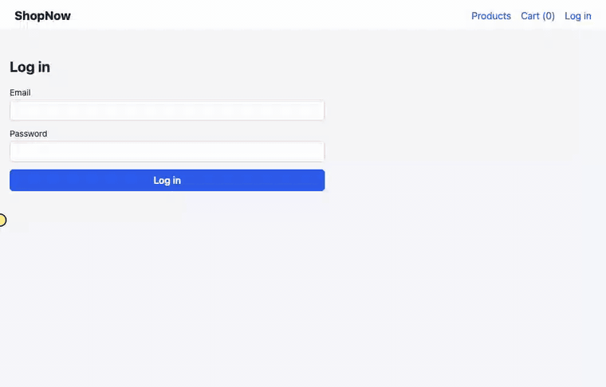<br><sub><b>BUG-02</b> · Ana opens Bruno's order by changing the URL</sub></td>
</tr>
<tr>
<td width="50%">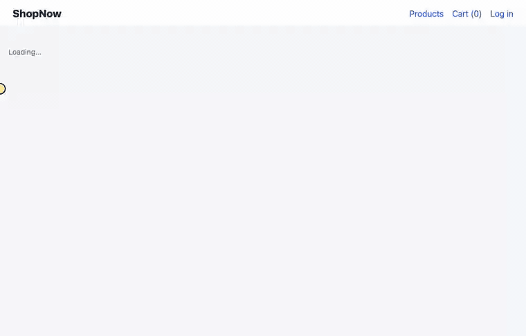<br><sub><b>BUG-06</b> · <code>flock10</code> applied with 0%</sub></td>
<td width="50%">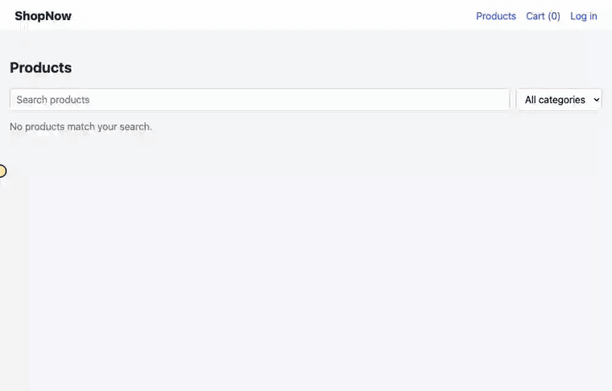<br><sub><b>BUG-08</b> · catalog "Add" lost on reload</sub></td>
</tr>
</table>

---

## 🗂️ Test types

| Type | What it validates | Command | Tests | Runs in CI |
|---|---|---|---|---|
| **API (business rules)** | Status codes, totals, discounts, stock, orders and payments created, JSON contract | `npm run test:api` | 26 | ✅ |
| **UI (user journeys)** | Cart, coupons, checkout, orders, catalog through the real screens | `npm run test:browser` | 18 | ✅ |
| **Mutants** | One field changed on a valid checkout or coupon → must be rejected | `npx playwright test --grep "@AC-05\|@AC-07"` | 10 | ✅ |
| **Concurrency** | 3 buyers, 2 chairs at the same time → 2 succeed, 1 gets 409, stock never negative | `npx playwright test --grep @STK-02` | 1 | ✅ |
| **Robustness** | Malformed payloads get 400 and the server stays up | `npx playwright test --grep @BUG-03` | 2 | ✅ (runs last) |
| **Controls** | Catalog search/filter, login, access, golden-path checkout, team's cart test | `npm run test:controls` | 8 | ✅ |
| **Priority slice** | Money, personal data and availability first | `npm run test:p1` | 22 | ✅ |
| **Performance** | Latency budgets (catalog p95, checkout vs the web client timeout) | `npm run perf` | 3 checks | ✅ separate job |

Every test can also be run by bug (`--grep @BUG-06`), acceptance criterion (`--grep @AC-07`) or case key (`--grep @CPN-05`).

---

## ✨ Highlights

- **Bugs that matter first:** the five Critical bugs are about money, personal data and availability, not cosmetics.
- **Expected values come from the spec:** an independent [oracle](#-the-oracle-where-expected-values-come-from) in integer cents and Argentina time, never copied from what the app returns.
- **Mutants of a valid request:** one changed field per test, with a passing control that proves the starting request is valid.
- **UI and API, each where it fits:** journeys through the screens, rules through the API (faster and more precise).
- **Concurrency:** a real race for the last two chairs, with three sessions at once.
- **Every test traced:** case key, acceptance criterion, requirement, bug and tags; [matrix](../docs/TRACEABILITY.md) generated from real runs.
- **Evidence you can check:** numbered steps, video with a visible pointer, failure boxed in red, "actual" read live from the app, HTTP log.
- **Proven tests:** the [`fixes`](https://github.com/criguex/shopnow-qa-challenge/tree/fixes) branch turns all 36 red tests green, one commit per bug.
- **AI driven by context, verified by hand:** a working agreement committed first, and a log of what was delegated, verified and discarded.

---

## 🏗️ Architecture

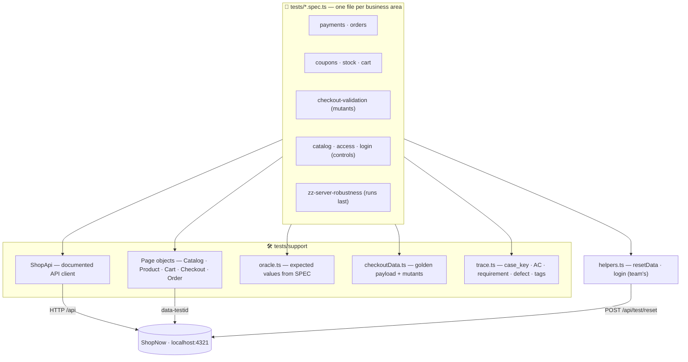

---

## 📁 Project structure

```text
shopnow-qa-challenge/
├── README.md                     # The challenge statement (unchanged)
├── ANALYSIS.md                   # PO questions, ambiguities, assumptions
├── BUGS.md                       # 15 bugs, prioritized, with evidence and root cause
├── TESTING.md                    # Strategy deep-dive: risk map, oracle, mutants, coverage
├── AGENTS.md · CLAUDE.md         # The AI's working agreement (first commit)
├── ai/
│   ├── README.md                 # AI usage: delegated · verified · discarded
│   └── probes/                   # ~70 exploratory API probes the reports are built on
├── tests/
│   ├── payments.spec.ts          # BUG-01
│   ├── orders.spec.ts            # BUG-02, BUG-13
│   ├── checkout-validation.spec.ts  # golden path + mutants: BUG-04, 09, 14, 15
│   ├── coupons.spec.ts           # BUG-05, 06, 11
│   ├── stock.spec.ts             # BUG-07 (incl. concurrent buyers), BUG-12
│   ├── cart.spec.ts              # team's test (strengthened), BUG-08, BUG-10
│   ├── catalog.spec.ts · access.spec.ts · login.spec.ts   # controls
│   ├── zz-server-robustness.spec.ts  # BUG-03, runs last on purpose
│   ├── helpers.ts                # team's helpers: resetData, login
│   └── support/
│       ├── shopApi.ts            # API client (one instance = one session)
│       ├── pages.ts              # page objects
│       ├── oracle.ts             # expected values from the spec
│       ├── checkoutData.ts       # golden checkout + mutants
│       └── trace.ts              # acceptance criteria + traceability metadata
├── evidence/
│   ├── record-evidence.mjs       # regenerates all evidence from a fresh app
│   └── BUG-01 … BUG-15/          # README sheet · BUG-XX-NN.png · .mp4 · .gif · logs
├── docs/
│   ├── API.md                    # challenge API docs (unchanged)
│   ├── TRACEABILITY.md           # generated matrix
│   ├── assets/                   # banner, diagram, explainer animation
│   └── scenes/                   # explainer source + exporter
├── perf/latency.mjs              # latency budgets (exit 1 when broken)
├── scripts/traceability.mjs      # builds docs/TRACEABILITY.md from JSON reports
├── .github/
│   ├── README.md · README.es.md  # this page
│   └── workflows/qa.yml          # CI: e2e + performance
└── app/                          # ShopNow (unchanged on main; fixed on branch fixes)
```

---

## 🧱 Design principles

### Page Object Model + API client

Every screen is a small class that hides *how* to use it behind intention-revealing methods (`quickAdd`, `applyCoupon`, `pay`). The API has its own client, `ShopApi`, so business rules are tested through the documented contract without going through the UI.

### SOLID, applied pragmatically

| Principle | How it shows up here |
|---|---|
| **S**ingle responsibility | `ShopApi` only speaks HTTP; each page object owns one screen; `oracle.ts` only computes expected values; `trace.ts` only describes traceability; specs only describe behaviour. |
| **O**pen/closed | A new mutant is a new entry in `QUANTITY_MUTANTS` / `MALFORMED_MUTANTS` or a case table; no test code changes. |
| **L**iskov substitution | Any `APIRequestContext` (the test's own or a new one per buyer) can back a `ShopApi`, which is how the concurrency test runs three sessions. |
| **I**nterface segregation | Small page objects, one per screen, instead of one "ShopNowPage" god object. |
| **D**ependency inversion | Specs depend on `ShopApi` and page objects, not on URLs or raw selectors; a changed selector is a one-line change. |

### Conventions

- **camelCase** for functions and variables (`goldenCheckout`, `expectedTotals`), **PascalCase** for classes (`ShopApi`, `CartPage`), **UPPER_CASE** for fixed data (`CATALOG`, `VALID_CARD`).
- **Arrange → Act → Assert** in every test, with one action under test.
- **Business-language titles**, prefixed with the bug ID: `[BUG-07] three customers buying the last two units at once: only two succeed and stock never goes negative`.
- **Strict TypeScript** (`tsc --noEmit` clean) and no parameter properties, so the suite runs on Node 22 and 26.
- **The challenge's test rules, audited before every push:** `resetData` in `beforeEach`, `data-testid` locators, no `app/` imports, no mocks, no fixed waits, no `test.fail/fixme/skip/only`, `playwright.config.ts` untouched.

---

## 🎯 Locator strategy

Only the app's `data-testid` attributes, as the challenge asks. No XPath, no CSS.

| Element | Locator | Why |
|---|---|---|
| Catalog "Add" | `getByTestId('quick-add-1')` | Stable per product |
| Quantity on product page | `getByTestId('quantity-select')` | The control under test |
| Cart line / total | `getByTestId('cart-line-total-1')` · `getByTestId('cart-total')` | Asserted to the cent |
| Coupon | `getByTestId('coupon-input')` · `getByTestId('coupon-applied')` · `getByTestId('coupon-error')` | Rule and message asserted |
| Checkout | `getByTestId('shipping-name')` · `getByTestId('card-number')` · `getByTestId('pay-button')` | Full payment journey |
| Outcome | `getByTestId('order-success')` · `getByTestId('checkout-error')` | What the customer is told |
| Orders | `getByTestId('order-row-2')` · `getByTestId('order-date')` | Date in Argentina time |

---

## 🔮 The oracle: where expected values come from

An assertion is only as good as its expected value. Here it **never comes from what the app returns today**:

- [`oracle.ts`](../tests/support/oracle.ts) recomputes money from the spec in **integer cents**: `expectedLineTotal(8.35, 3)` is `25.05` no matter how the app does its floating-point maths.
- Dates are recomputed with `Intl` in `America/Argentina/Buenos_Aires` (`argentinaDate`), independent of the server's formatter.
- Status codes come from [`docs/API.md`](../docs/API.md) (`400`, `401`, `402`, `409`); rules from [`SPEC.md`](../SPEC.md) (one coupon, case-insensitive, minimum 1, stock limit).
- The oracle never imports from `app/`; that would be a mirror, not an oracle.

What is asserted is always a **business outcome**: totals, discounts, stock after the action, how many orders and payments were created, status codes and the exact message the customer sees. "Element is visible" alone is never the assertion.

---

## 🧬 Mutant scenarios

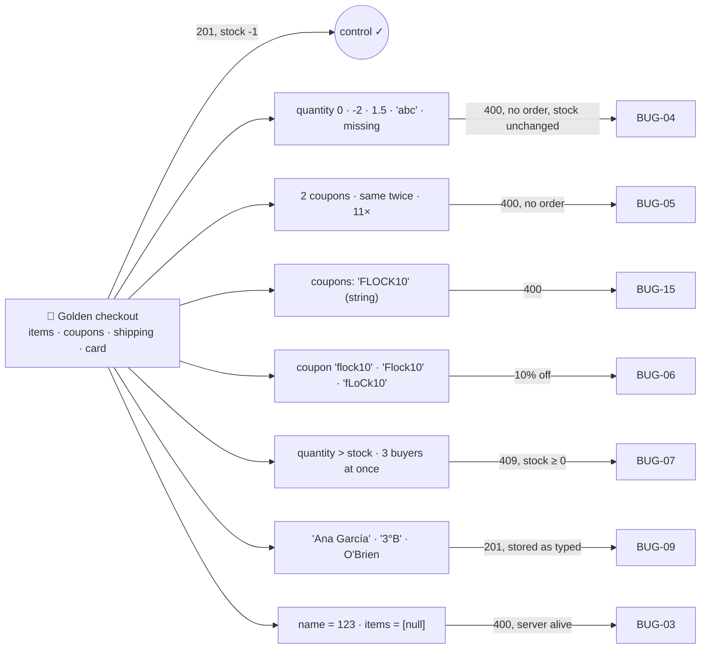

| Class | Intent | Example | Expected |
|---|---|---|---|
| `equivalent` | Must not change the result | `flock10`, `Flock10` for `FLOCK10` | same 10% discount |
| `boundary` | Edge that must still work, or must stop | quantity `0`, stock + 1, 3 × $8.35 | `400` / `409` / `$25.05` |
| `negative` | Must be rejected | quantity `-2`, `"abc"`, 11 coupons | `400`, nothing created |
| `type` | Wrong JSON type | `shipping.name: 123`, `items: [null]`, `coupons: "FLOCK10"` | `400`, server stays up |
| `real-world data` | Valid input the app forgot | `Ana García`, `Av. Corrientes 1234, 3°B`, `O'Brien` | `201`, stored as typed |

A mutant changes **one** thing in a request that is known to work. If the system accepts a mutant it should reject, or crashes, that is a finding. The control test proves the starting request is green, so a red mutant means the rule is broken, not the test.

---

## 🧪 Key scenarios

### BUG-01 · Why user report 1 happens

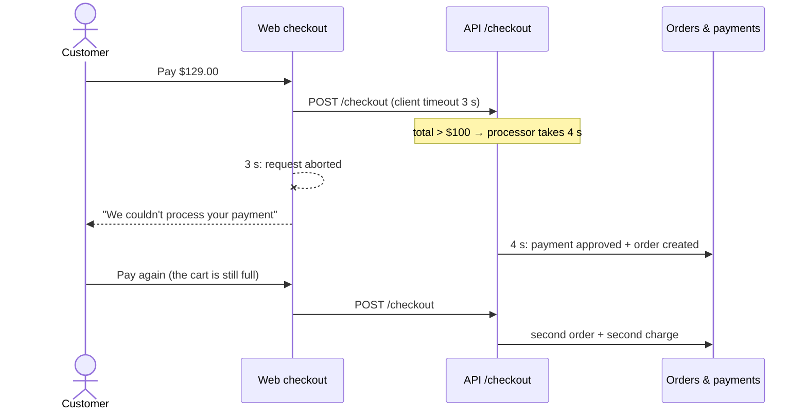

The test logs in, buys the $129 chair with a valid card and asserts the **order confirmation** and **exactly one $129.00 payment**. A second test asserts that a declined card over $100 says *"The payment was declined by the bank."*

### BUG-07 · Three customers, two chairs

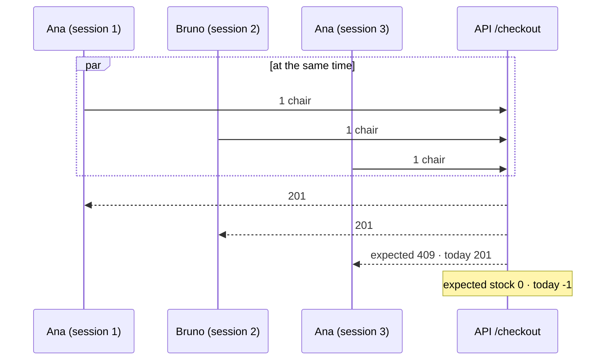

---

## 🧵 Traceability

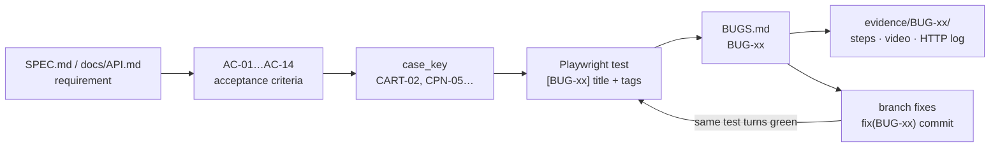

- **In the code:** [`trace.ts`](../tests/support/trace.ts) defines the 14 acceptance criteria and gives each test its `case_key`, `ac`, `requirement` and `defect` annotations plus tags: layer `@api`/`@ui`, priority `@P1`–`@P3`, `@AC-xx`, `@BUG-xx` and the case key. The annotations show up in the HTML report.
- **Matrix:** [`docs/TRACEABILITY.md`](../docs/TRACEABILITY.md) is generated by `npm run traceability` from the Playwright JSON reports of `main` and `fixes`: coverage per criterion, and per case its requirement, bug, evidence and result on each branch.
- **In the reports:** every bug in [`BUGS.md`](../BUGS.md) lists its evidence folder, the resource URL, the test cases, the criteria and the fix commit.
- **In git:** small commits, one per step, on `main`; one `fix(BUG-xx)` commit per bug on `fixes`.

| Criterion | Tests | Bugs |
|---|---|---|
| AC-01 Search and filter | 3 | — |
| AC-02 Add from catalog and product page | 2 | BUG-08 |
| AC-03 Can't buy more than the stock | 3 | BUG-07, BUG-12 |
| AC-04 Totals exact to the cent | 5 | BUG-10 |
| AC-05 Whole quantities, minimum 1 | 5 | BUG-04 |
| AC-06 Cart persists | 2 | BUG-08 |
| AC-07 One coupon per purchase | 5 | BUG-05, BUG-11, BUG-15 |
| AC-08 Case-insensitive codes | 5 | BUG-06 |
| AC-09 Discount = % of subtotal | 2 | BUG-06 |
| AC-10 Log in before paying | 3 | — |
| AC-11 Checkout outcome is the real one | 6 | BUG-01, BUG-09 |
| AC-12 Only your own orders | 3 | BUG-02 |
| AC-13 Argentina time | 2 | BUG-13 |
| AC-14 API contract and availability | 14 | BUG-03, 04, 05, 07, 14, 15 |

---

## 📸 Evidence

Each bug has its own folder `evidence/BUG-XX/`. Its `README.md` is the defect's evidence sheet:

- **Environment:** app version, browser, time zone, data, users, recording time, plus a link to the resource.
- **Expected vs actual:** the "actual" value is **read live from the app** while recording, not typed by hand.
- **UI bugs:** numbered step screenshots (`BUG-XX-01.png`, `-02`…) and a video with a visible pointer, a banner describing each step and the failure boxed in red with expected vs actual (MP4 + GIF).
- **API bugs:** the HTTP log of every call (method, path, status, request and response bodies), plus screenshots of what the customer then sees. BUG-04, for example, shows a -$28.70 "approved" payment and a blank My payments page.
- **BUG-03:** the real server log of the crash.

`npm run evidence` regenerates all of it from a fresh app, so the evidence is reproducible, not hand-made.

---

## 🩹 Fix branch: proof that the tests are right

A red test only proves something if it turns green when the bug is fixed. The optional extension lives on branch [`fixes`](https://github.com/criguex/shopnow-qa-challenge/tree/fixes), kept apart so `main` keeps showing the bugs:

- one minimal commit per bug, `fix(BUG-xx): …`, pointing at the root cause written in `BUGS.md`;
- the same 44 tests: **36 red on `main` → 44/44 green on `fixes`**, locally and in CI;
- the latency budget follows the new client timeout, so the performance job is green there too.

```bash
git switch fixes && npm test     # 44 passed
```

---

## 📈 Performance

[`perf/latency.mjs`](../perf/latency.mjs) is plain Node (no extra dependencies) and checks two budgets:

| Check | Budget | Measured on `main` |
|---|---|---|
| `GET /products` p95, 30 concurrent requests | 200 ms | ~9 ms ✅ |
| `POST /checkout`, total ≤ $100 | 3,000 ms (web client timeout) | ~0.7 s ✅ |
| `POST /checkout`, total > $100 | 3,000 ms | **~4.0 s ❌**: the root of BUG-01 |

It exits with code 1 when a budget breaks, so CI can gate on it. It is a probe, not a load test: one local process with a JSON file as database would give meaningless stress numbers.

---

## 🚀 Getting started

### Prerequisites

- **Node.js 22** (`.nvmrc`) and git. Node 26 also works; see [Environment notes](#-environment-notes).

### Install & run

```bash
git clone https://github.com/criguex/shopnow-qa-challenge.git
cd shopnow-qa-challenge
npm install            # also installs Chromium
npm test               # the full suite; starts the app if it isn't running
```

Expected output on `main` (bugs open):

```text
Running 44 tests using 1 worker
  ✓  access.spec.ts › a guest who goes to checkout is asked to log in and returns to checkout
  ✓  access.spec.ts › the API refuses checkout, orders and payments without a session
  ✓  cart.spec.ts › the cart total is calculated correctly
  ✘  cart.spec.ts › [BUG-08] a product added with the catalog Add button is still in the cart after reloading
  ✘  cart.spec.ts › [BUG-10] cart shows 3 × $8.35 = $25.05
  …
  36 failed
  8 passed
```

Each failure says why, in business terms:

```text
[BUG-10] cart shows 3 × $8.35 = $25.05          Expected string: "$25.05"  Received string: "$25.04"
[BUG-06] validating "flock10" returns …          Expected: 10               Received: 0
[BUG-07] checkout rejects a quantity above …     Expected: 409              Received: 201
[BUG-13] the API shows the order date …          Expected: "10/14/2026"     Received: "10/15/2026"
```

And on the fix branch:

```bash
git switch fixes && npm test      # 44 passed
```

---

## 🧰 Available scripts

| Script | Description |
|---|---|
| `npm test` | Full suite (44 tests) |
| `npm run test:api` | API tests only (`@api`, 26) |
| `npm run test:browser` | UI tests only (`@ui`, 18) |
| `npm run test:p1` | Priority 1 only (`@P1`, 22; `@P2` has 17, `@P3` 5) |
| `npm run test:controls` | The 8 controls that must pass today |
| `npx playwright test --grep @BUG-06` | One bug (also `@AC-07`, `@CPN-05`, `@P2`…) |
| `npm run test:ui` | Playwright UI mode |
| `npm run report` | Open the last HTML report (traces of the failures) |
| `npm run typecheck` | `tsc --noEmit` |
| `npm run perf` | Latency budgets (app running) |
| `npm run evidence` | Re-record the evidence of every bug (fresh app) |
| `npm run traceability -- <main.json> [fixes.json]` | Rebuild `docs/TRACEABILITY.md` from JSON reports |
| `npm run docs:animation` | Re-export the explainer GIF/MP4 |
| `npm run dev` / `npm run reset` | Start the app / reset its data (challenge scripts) |

---

## ⚙️ Configuration

[`playwright.config.ts`](../playwright.config.ts) is the challenge's and is **not modified**: base URL `http://localhost:4321`, one worker, no retries, Chromium, `en-US`, time zone `America/Argentina/Buenos_Aires`, trace kept on failure, and the web server started by the suite when needed.

- **One worker on purpose:** every test resets the shared data, so tests run one after another.
- **Test data:** the seed users `ana@shopnow.test` and `bruno@shopnow.test`; the catalog prices and stock live in the oracle (`CATALOG`).
- **Timeouts:** checkout requests in `ShopApi` allow 15 s, because the simulated processor takes up to 4 s.

---

## 📊 Reports & artifacts

- **HTML report** → `playwright-report/` (`npm run report`), with the `case_key`, `ac`, `requirement` and `defect` annotations on every test.
- **Traces** → kept for every failing test (`trace: retain-on-failure`).
- **Traceability matrix** → [`docs/TRACEABILITY.md`](../docs/TRACEABILITY.md).
- **Evidence** → [`evidence/BUG-XX/`](../evidence).
- **CI artifact** → `playwright-report` uploaded on every run.

---

## 🤖 Continuous integration

[`.github/workflows/qa.yml`](workflows/qa.yml) runs on every push and pull request:

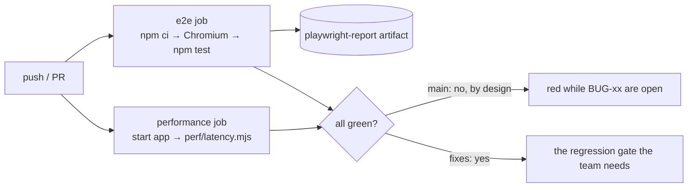

| Branch | e2e | performance | Meaning |
|---|---|---|---|
| `main` | ❌ 36 failed · 8 passed | ❌ checkout > $100 takes ~4 s | the bugs are there |
| `fixes` | ✅ 44 passed | ✅ within budget | the same tests guard the fixes |

---

## 🧠 How AI was used

The full log is in [`ai/README.md`](../ai/README.md). In short:

- **Context first:** [`AGENTS.md`](../AGENTS.md) (method, validation rules, the challenge's test rules) loaded through [`CLAUDE.md`](../CLAUDE.md), committed before anything else.
- **Delegated to Claude Code (Claude Opus 5.5):** reading the code for suspects, ~70 API probes, the Playwright suite, the evidence recorder, the traceability generator, drafts of the documents.
- **Owned by me:** risk and priority calls, what is a bug vs. a question, the evidence standard, every verdict.
- **Verified:** each bug reproduced live before reporting; each red test checked to fail *for its bug*; the suite proven by turning green on `fixes`; the evidence reviewed frame by frame.
- **Discarded or corrected:** a duplicated bug, undefined behaviours reported as bugs, a `test.fail` rule the challenge forbids, a weak first evidence pass, links to the wrong port, a fix that broke the type check, and more, all listed with the reason.

---

## 🧯 Environment notes

- **Node 26 + Playwright 1.48:** `npm install` downloaded Chromium but hung while extracting it. Unzipping the downloaded archive into `~/Library/Caches/ms-playwright/chromium-1140` fixes it. Node 22 (the repo's `.nvmrc`) avoids it.
- **Node 26 type stripping:** TypeScript parameter properties (`constructor(private page)`) break Playwright's loader, so the support classes declare their fields explicitly.
- **Port 4321 busy:** `npm test` can't start the app, and the port is fixed by the challenge rules. Free the port; don't change the config.
- **BUG-03 kills the server:** while it's open, run the crash tests last (they already are) and restart the app after `npm run evidence`.

---

## 🛠️ Tech stack

| Tool | Role |
|---|---|
| [Playwright Test 1.48](https://playwright.dev/) | Runner, browser automation, API requests, reporters, video |
| [TypeScript 5.6](https://www.typescriptlang.org/) | Strict typing for tests and support code |
| Node.js `fetch` | Exploratory probes and the latency probe, with no extra dependencies |
| [ffmpeg](https://ffmpeg.org/) | MP4/GIF evidence and the explainer animation |
| [GitHub Actions](https://github.com/features/actions) | CI: e2e and performance jobs |
| [Claude Code](https://www.anthropic.com/claude-code) | AI agent, driven by `AGENTS.md` / `CLAUDE.md` |

---

## 👤 Author

**Cristian Guerra**, QA Automation Engineer · [GitHub @criguex](https://github.com/criguex)

Built as a technical challenge submission.
