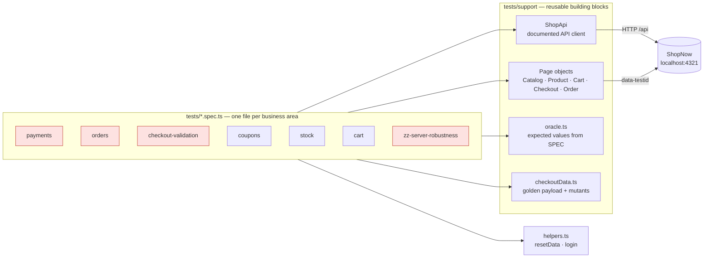
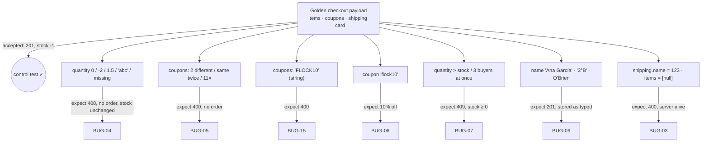
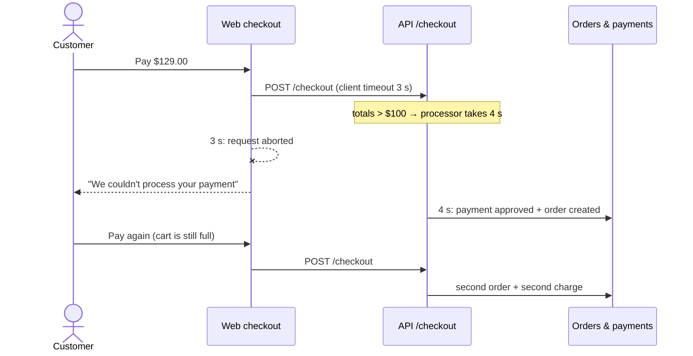
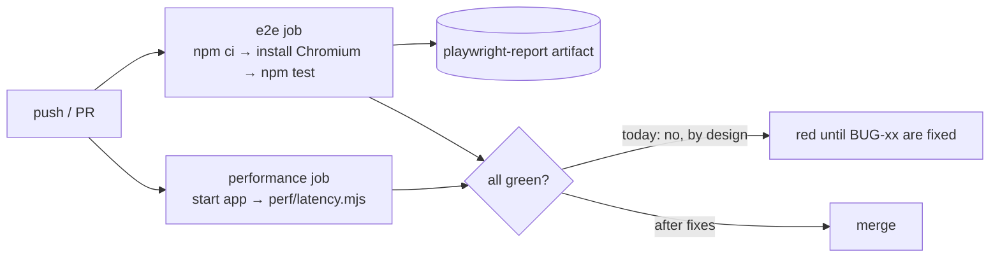
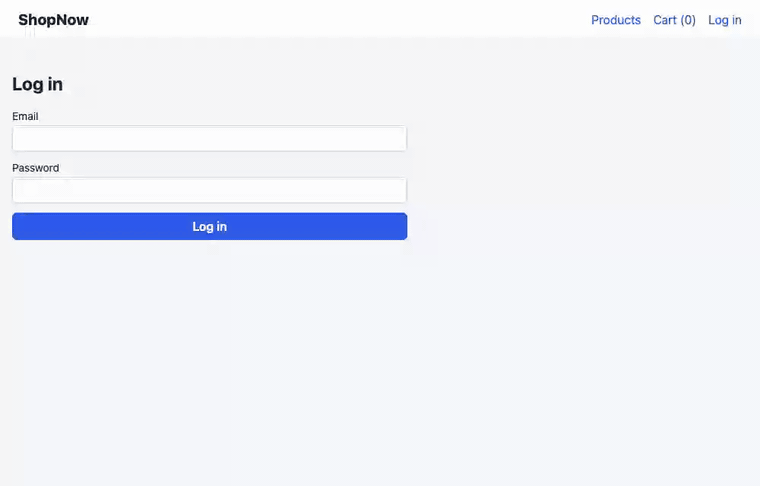
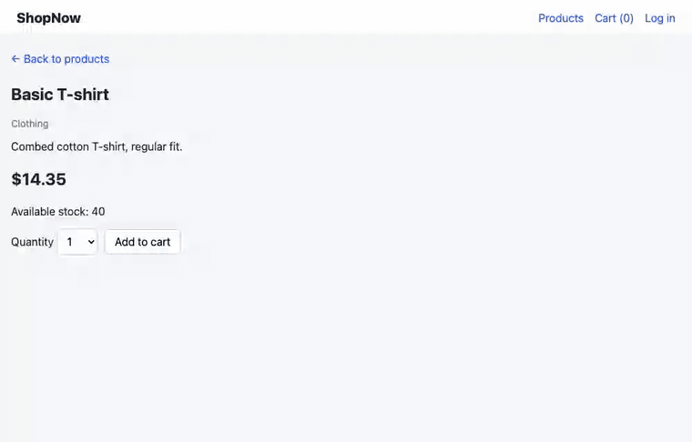
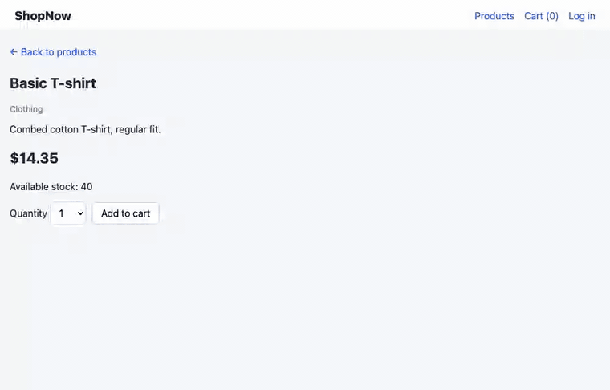
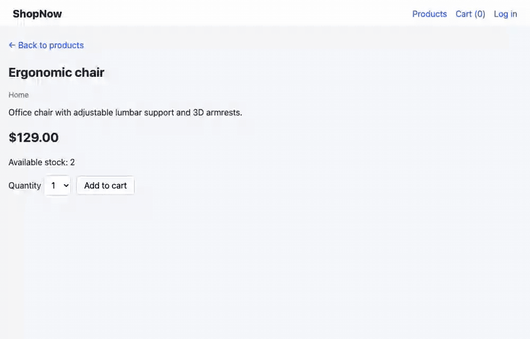
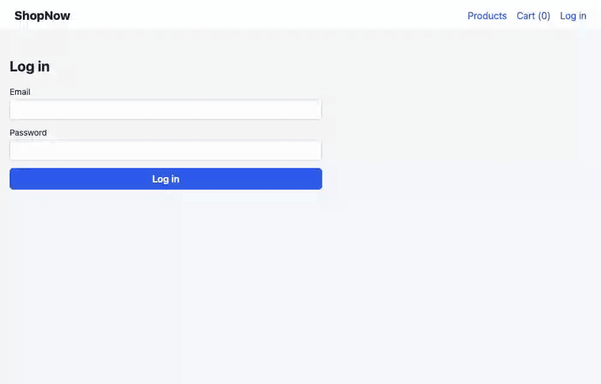

# Testing ShopNow — strategy, design and how to run it

This file explains how the QA work in this repo is organised. The deliverables are `ANALYSIS.md`, `BUGS.md`, `tests/` and `ai/README.md`; this page is the map that ties them together. (`README.md` is the challenge statement and is left untouched.)

## TL;DR

| What | Result |
|---|---|
| Bugs reported | **15** (`BUG-01`…`BUG-15`): 5 Critical, 5 High, 3 Medium, 2 Low · 3 user reports + 12 found by me |
| Playwright tests | **39**: 36 fail today, one or more per bug, with the bug ID in the name · 3 controls pass (golden path, login, the team's cart test) |
| Techniques | risk-based priority · independent oracle · golden path + mutants · boundary values · state transitions · concurrency · UI + API |
| Extra | latency probe with budgets (`perf/`) · CI pipeline (`.github/workflows/qa.yml`) · GIF evidence (`evidence/`) |

## How to run

```bash
npm install
npm test                      # full suite; starts the app if it isn't running
npx playwright test -g "BUG-06"   # only one bug
npx playwright show-report    # HTML report with traces of the failures
node perf/latency.mjs         # latency budgets (app must be running)
```

**Red is the expected result today.** Every failing test names its bug, so the report reads like a bug list. When the team fixes a bug, its tests turn green and stay as regression tests. `zz-server-robustness.spec.ts` runs last on purpose: while BUG-03 is open it crashes the server, and anything after it would fail for the wrong reason.

## How the suite is built



Rules every test follows (from the challenge README and `AGENTS.md`):

- `resetData` in `beforeEach` → every test starts from the seed, in any order.
- Locators only through `data-testid`; no fixed waits, only web-first assertions.
- Tests talk to the app only through the UI or the documented API — never `app/` files, no mocks.
- No `test.fail/fixme/skip/only`: a test is plain and fails because of the bug.

### Design principles

| Principle | Where you can see it |
|---|---|
| **Single responsibility** | `ShopApi` only speaks HTTP; each page object only knows its screen; `oracle.ts` only computes expected values; specs only describe behaviour. |
| **Open/closed** | A new mutant is a new entry in `QUANTITY_MUTANTS` / `MALFORMED_MUTANTS` or in a case table; no test code changes. |
| **Interface segregation** | Small page objects (one per screen) instead of one "ShopNowPage" god object. |
| **Dependency inversion** | Specs depend on `ShopApi` and page objects, not on URLs or raw selectors; if a selector changes, one line changes. |
| **AAA** | Each test is Arrange (reset, login, data) → Act (one action) → Assert (business outcome). |
| **Naming** | camelCase for functions/variables (`goldenCheckout`, `expectedTotals`), PascalCase for classes (`ShopApi`, `CartPage`), UPPER_CASE for fixed data (`CATALOG`, `VALID_CARD`). Test titles are sentences about the business rule, prefixed with the bug ID. |

### The oracle: where expected values come from

An assertion is only as good as its expected value. The expected value **never comes from what the app returns today**:

- `oracle.ts` recomputes money from the spec in integer cents (`expectedLineTotal`, `expectedTotals`), so 3 × $8.35 is $25.05 regardless of the app's floating-point maths.
- Dates are recomputed with `Intl` in `America/Argentina/Buenos_Aires` (`argentinaDate`), independent of the server's formatter.
- Status codes come from `docs/API.md` (`400`, `402`, `409`), rules from `SPEC.md` (one coupon, case-insensitive, min 1, stock limit).
- The oracle never imports from `app/`; it would be a mirror, not an oracle.

What is asserted is always a **business outcome**: totals, discounts, stock after the action, number of orders/payments created, status codes, the exact message shown. "Element is visible" alone is never the assertion.

### Golden path + mutants



A mutant changes **one** thing of a request that is known to work. If the system accepts a mutant it should reject (or crashes), that is a finding. The control test (`golden path`) proves the baseline is green, so a red mutant means the rule is broken, not the test.

### Risk map → priority

| Area | Impact | Likelihood | What I tested first |
|---|---|---|---|
| Payment / checkout | money, double charges | high (user report 1) | slow payments, retries, declines, totals |
| Authorization | personal data | medium | other users' orders (UI + API) |
| Availability | whole store | low effort to trigger | malformed payloads |
| Coupons | money | high (user report 2) | casing, stacking, reloads |
| Stock | overselling | medium | over-stock, races, repeated adds |
| Cart persistence | lost sales | high (user report 3) | each way of adding, reloads |
| Money maths | small but systematic | certain for some prices | every seed price × 1..10 |
| Dates | confusion | every late-night order | seed order at 02:30 UTC |

### Coverage matrix (spec → tests)

| SPEC rule | Test file | Bugs |
|---|---|---|
| Search and filter by category | explored manually (works) | — |
| Can't buy more than the stock | `stock.spec.ts` | BUG-07, BUG-12 |
| Cart totals, quantities (min 1) | `cart.spec.ts`, `checkout-validation.spec.ts` | BUG-04, BUG-10 |
| Cart persists after closing the browser | `cart.spec.ts` | BUG-08 |
| One coupon per purchase | `coupons.spec.ts` | BUG-05, BUG-11, BUG-15 |
| Coupons are case-insensitive | `coupons.spec.ts` | BUG-06 |
| Discount = % of subtotal | `coupons.spec.ts` (oracle) | BUG-06 |
| Login required before paying | explored (works) + `[EXAMPLE]` test | — |
| Shipping details + card, payment, order | `payments.spec.ts`, `checkout-validation.spec.ts`, `zz-server-robustness.spec.ts` | BUG-01, BUG-03, BUG-09, BUG-14 |
| Two decimals | `cart.spec.ts` | BUG-10 |
| My orders / detail (own orders) | `orders.spec.ts` | BUG-02 |
| Argentina time | `orders.spec.ts` | BUG-13 |
| Confirmation email | not verifiable locally → ANALYSIS.md Q9 | — |

### Why report 1 happens (sequence)



## Performance

`perf/latency.mjs` (plain Node, no dependencies) checks two budgets:

| Check | Budget | Measured locally |
|---|---|---|
| `GET /products` p95 with 30 concurrent requests | 200 ms | ~9 ms ✓ |
| `POST /checkout` ≤ $100 | 3,000 ms (web client timeout) | ~0.7 s ✓ |
| `POST /checkout` > $100 | 3,000 ms | **~4.0 s ✗** → root of BUG-01 |

It exits with code 1 when a budget is broken, so the pipeline can gate on it. It is a probe, not a load test: the app is a single local process with a JSON file as database, so stress numbers here would say nothing about production.

## Pipeline



`.github/workflows/qa.yml` runs both jobs on every push. It is red today on purpose: it is the regression gate the team needs once the fixes land.

## Evidence

| Bug | GIF |
|---|---|
| BUG-01 payment "failed" but charged |  |
| BUG-02 Ana reads Bruno's order |  |
| BUG-06 lowercase coupon = 0% |  |
| BUG-08 catalog Add lost on reload |  |
| BUG-11 second coupon after reload |  |
| BUG-12 cart above stock |  |
| BUG-13 late-night order date |  |

The GIFs are the real Playwright tests recorded in slow motion; the last frame of each is the wrong state the test catches.

## Environment notes

- With **Node 26**, `npm install` (Playwright 1.48.2) downloaded Chromium but hung while extracting it. Workaround used: unzip the downloaded archive into `~/Library/Caches/ms-playwright/chromium-1140`. The repo's `.nvmrc` says Node 22, which avoids it.
- With Node 26, TypeScript **parameter properties** (`constructor(private page)`) break Playwright's loader ("not supported in strip-only mode"), so the support classes declare their fields explicitly.
- If port 4321 is taken, `npm test` can't start the app (the port is fixed by the challenge rules); free the port instead of changing the config.
