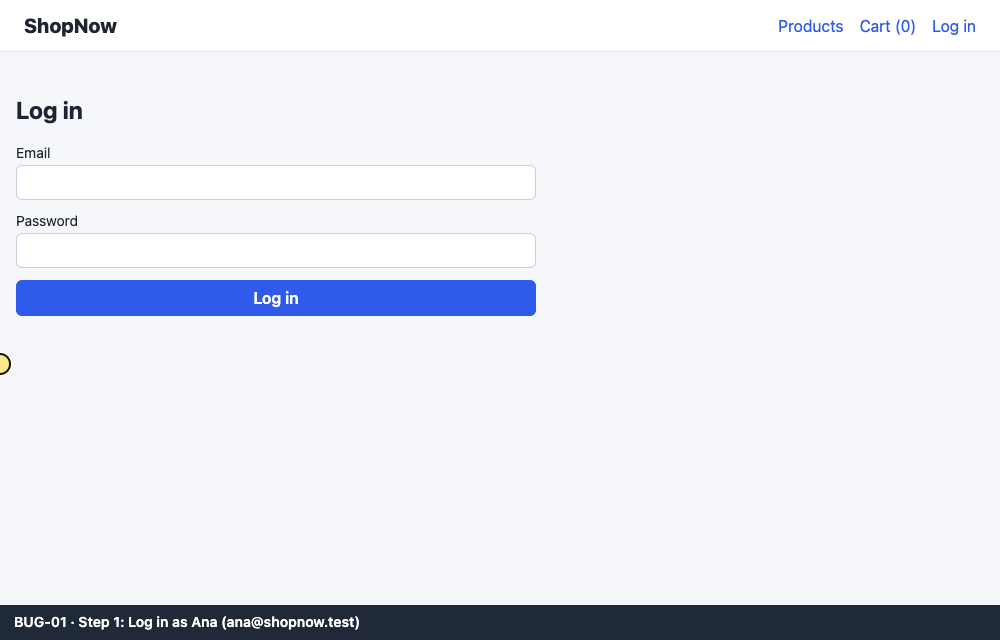
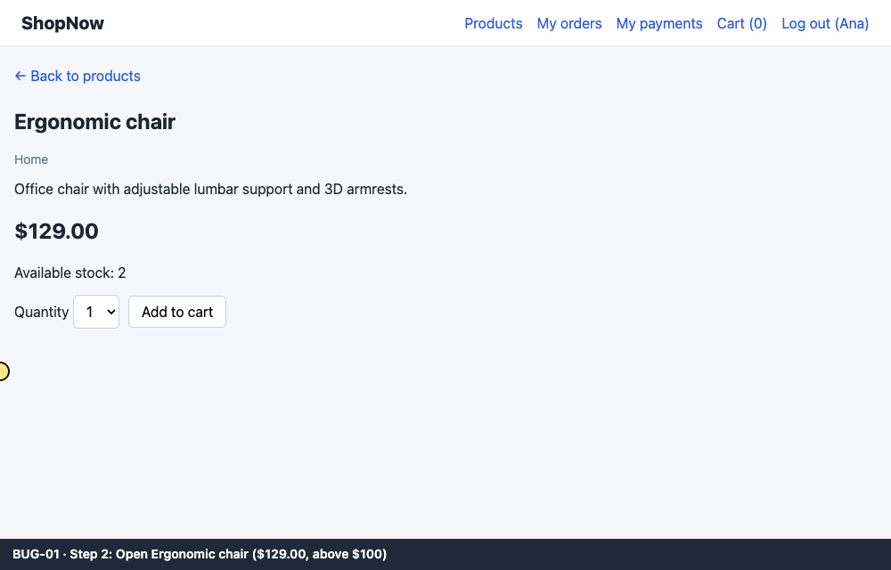
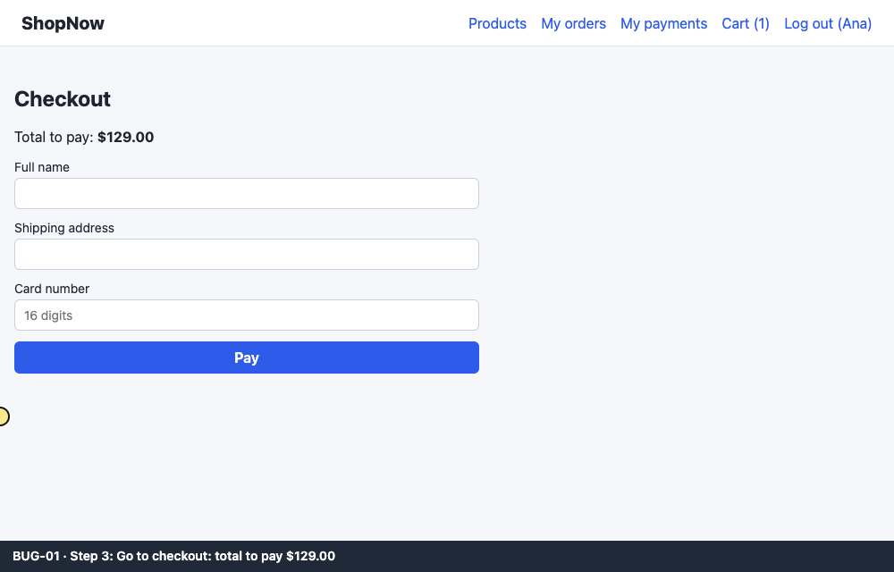
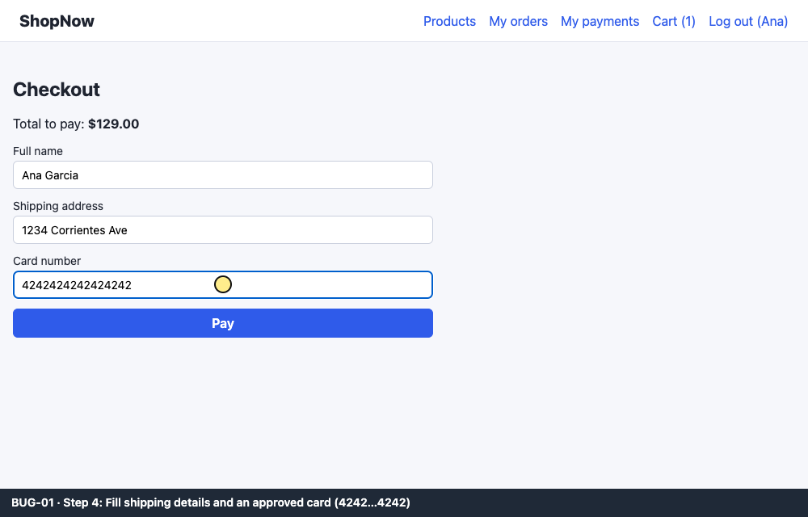
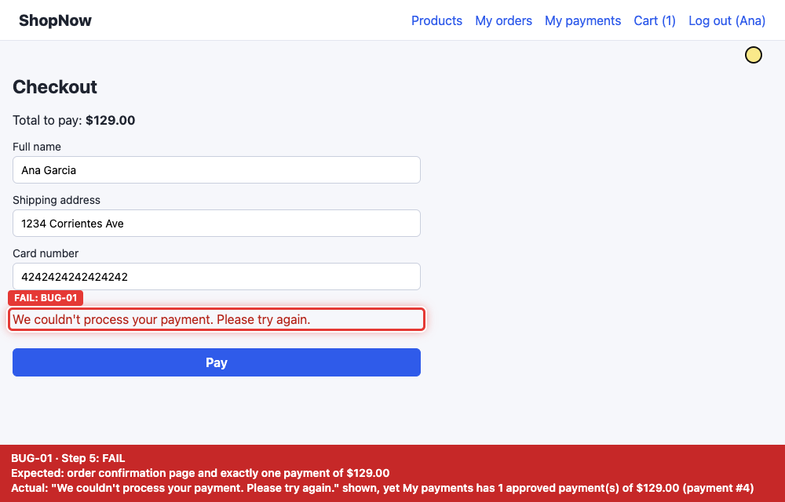

# BUG-01 — Payments over $100 are reported as failed but the customer is charged

- **Environment:** ShopNow local (`npm run dev`) · app version: commit `40bc732` · Chromium (Playwright 1.48.2) · timezone America/Argentina/Buenos_Aires · fresh data (`POST /api/test/reset`) · users ana@shopnow.test / bruno@shopnow.test · recorded 2026-11-13 15:36 UTC on http://localhost:4322 (port 4321 was in use on the recording machine; same app and data)
- **Resource:** [http://localhost:4321/checkout](http://localhost:4321/checkout)
- **Acceptance criteria:** AC-11 (see docs/TRACEABILITY.md) · **Report:** [BUGS.md](../../BUGS.md) › BUG-01
- **Automated test:** `tests/payments.spec.ts (PAY-01, PAY-02)`

## Expected vs actual

- **Expected:** order confirmation page and exactly one payment of $129.00
- **Actual:** "We couldn't process your payment. Please try again." shown, yet My payments has 1 approved payment(s) of $129.00 (payment #4)

## Video

Full quality: [BUG-01.mp4](BUG-01.mp4) (pointer visible, step banners, failure marked in red).

## Steps

### Step 1 — Log in as Ana (ana@shopnow.test)

### Step 2 — Open Ergonomic chair ($129.00, above $100)

### Step 3 — Go to checkout: total to pay $129.00

### Step 4 — Fill shipping details and an approved card (4242…4242)

### Step 5 — Failure: expected vs actual

## HTTP log

| # | Request | Status | Request body | Response (first 300 chars) |
|---|---|---|---|---|
| 1 | `GET /api/me` | **401** |  | `{"error":"Not logged in."}` |
| 2 | `POST /api/login` | **200** | `{"email":"ana@shopnow.test","password":"Ana12345"}` | `{"id":1,"name":"Ana Garcia","email":"ana@shopnow.test"}` |
| 3 | `GET /api/products?` | **200** |  | `[{"id":1,"name":"Ceramic mug","category":"Home","price":8.35,"stock":25,"description":"350 ml glazed ceramic mug. Microwave safe."},{"id":2,"name":"Bluetooth headphones","category":"Tech","price":49.99,"stock":3,"description":"Wireless headphones with 20 hours of battery and a charging case."},{"id"` |
| 4 | `GET /api/products/8` | **200** |  | `{"id":8,"name":"Ergonomic chair","category":"Home","price":129,"stock":2,"description":"Office chair with adjustable lumbar support and 3D armrests."}` |
| 5 | `GET /api/me` | **200** |  | `{"id":1,"name":"Ana Garcia","email":"ana@shopnow.test"}` |
| 6 | `GET /api/me` | **200** |  | `{"id":1,"name":"Ana Garcia","email":"ana@shopnow.test"}` |
| 7 | `GET /api/payments` | **200** |  | `[{"id":4,"userId":1,"orderId":4,"amount":129,"cardLast4":"4242","status":"approved","createdAt":"2026-11-13T15:36:28.563Z"},{"id":2,"userId":1,"orderId":2,"amount":24.55,"cardLast4":"4242","status":"approved","createdAt":"2026-10-15T02:30:00.000Z"},{"id":1,"userId":1,"orderId":1,"amount":28.7,"cardL` |
