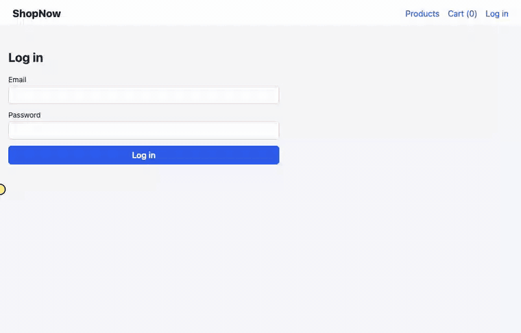
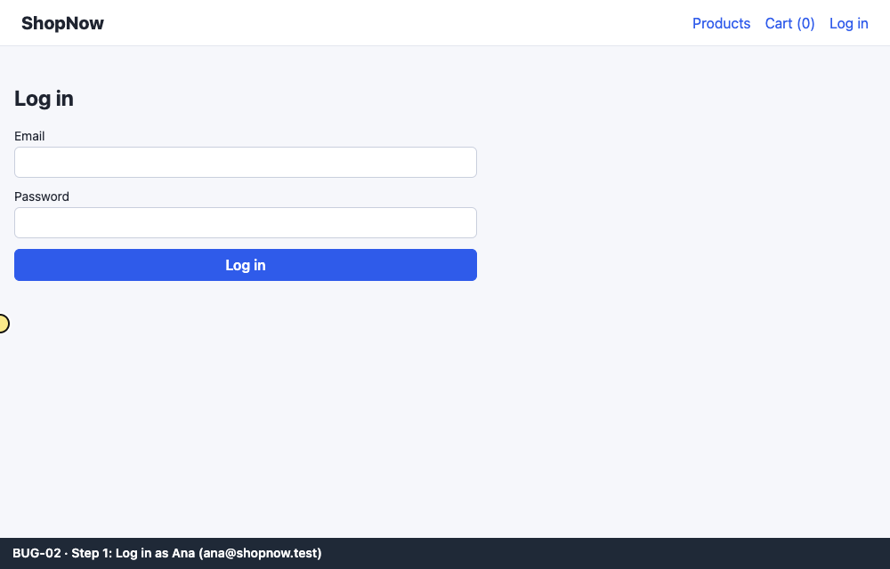
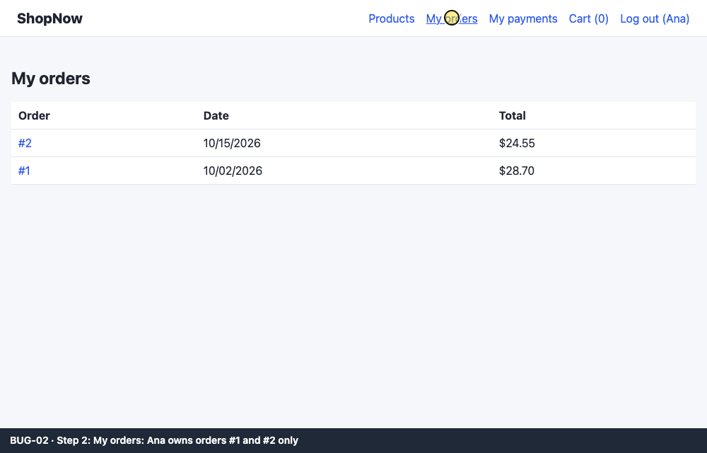
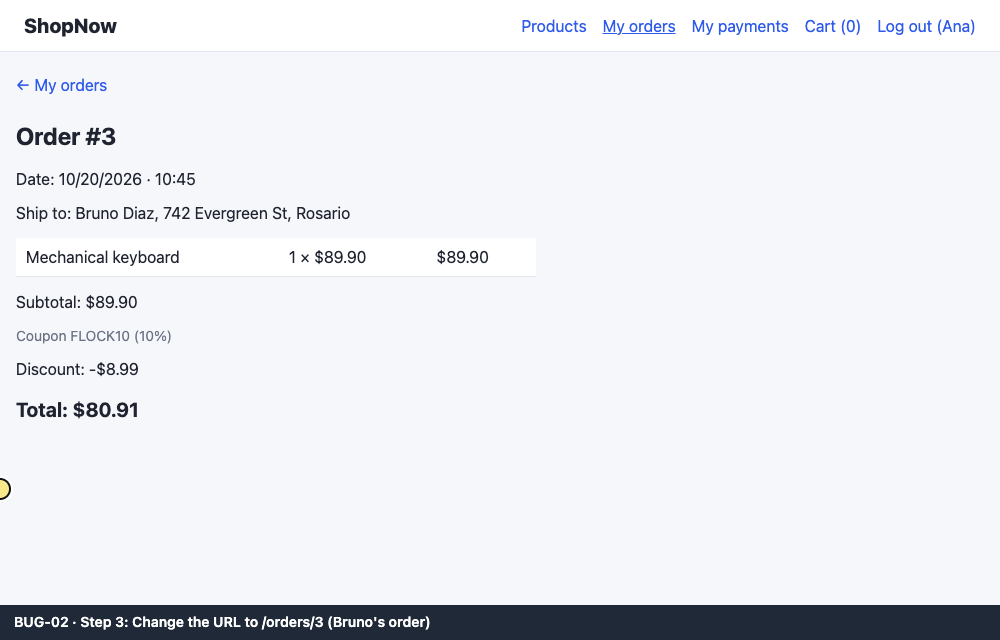
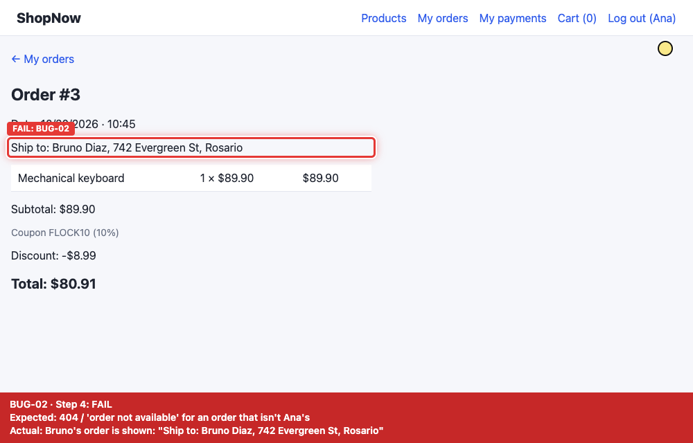

# BUG-02 — Any logged-in user can read other customers' orders

- **Environment:** ShopNow local (`npm run dev`) · app version: commit `40bc732` · Chromium (Playwright 1.48.2) · timezone America/Argentina/Buenos_Aires · fresh data (`POST /api/test/reset`) · users ana@shopnow.test / bruno@shopnow.test · recorded 2026-11-13 15:36 UTC on http://localhost:4322 (port 4321 was in use on the recording machine; same app and data)
- **Resource:** [http://localhost:4321/orders/3](http://localhost:4321/orders/3)
- **Acceptance criteria:** AC-12 (see docs/TRACEABILITY.md) · **Report:** [BUGS.md](../../BUGS.md) › BUG-02
- **Automated test:** `tests/orders.spec.ts (ORD-01, ORD-02)`

## Expected vs actual

- **Expected:** 404 / 'order not available' for an order that isn't Ana's
- **Actual:** Bruno's order is shown: "Ship to: Bruno Diaz, 742 Evergreen St, Rosario"

## Video

Full quality: [BUG-02.mp4](BUG-02.mp4) (pointer visible, step banners, failure marked in red).

## Steps

### Step 1 — Log in as Ana (ana@shopnow.test)

### Step 2 — My orders: Ana owns orders #1 and #2 only

### Step 3 — Change the URL to /orders/3 (Bruno's order)

### Step 4 — Failure: expected vs actual

## HTTP log

| # | Request | Status | Request body | Response (first 300 chars) |
|---|---|---|---|---|
| 1 | `GET /api/me` | **401** |  | `{"error":"Not logged in."}` |
| 2 | `POST /api/login` | **200** | `{"email":"ana@shopnow.test","password":"Ana12345"}` | `{"id":1,"name":"Ana Garcia","email":"ana@shopnow.test"}` |
| 3 | `GET /api/products?` | **200** |  | `[{"id":1,"name":"Ceramic mug","category":"Home","price":8.35,"stock":25,"description":"350 ml glazed ceramic mug. Microwave safe."},{"id":2,"name":"Bluetooth headphones","category":"Tech","price":49.99,"stock":3,"description":"Wireless headphones with 20 hours of battery and a charging case."},{"id"` |
| 4 | `GET /api/orders` | **200** |  | `[{"id":2,"userId":1,"createdAt":"2026-10-15T02:30:00.000Z","items":[{"productId":5,"name":"Desk lamp","price":24.55,"quantity":1}],"coupons":[],"subtotal":24.55,"discount":0,"total":24.55,"shipping":{"name":"Ana Garcia","address":"1234 Corrientes Ave, Buenos Aires"},"paymentId":2,"displayDate":"10/1` |
| 5 | `GET /api/me` | **200** |  | `{"id":1,"name":"Ana Garcia","email":"ana@shopnow.test"}` |
| 6 | `GET /api/orders/3` | **200** |  | `{"id":3,"userId":2,"createdAt":"2026-10-20T13:45:00.000Z","items":[{"productId":6,"name":"Mechanical keyboard","price":89.9,"quantity":1}],"coupons":[{"code":"FLOCK10","percent":10}],"subtotal":89.9,"discount":8.99,"total":80.91,"shipping":{"name":"Bruno Diaz","address":"742 Evergreen St, Rosario"},` |
