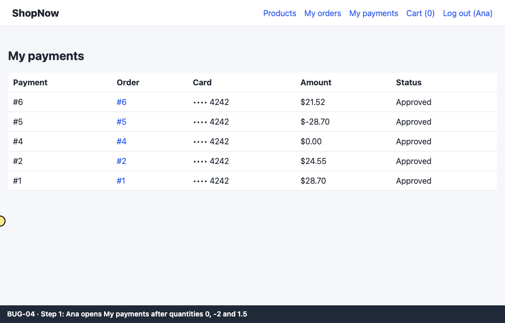
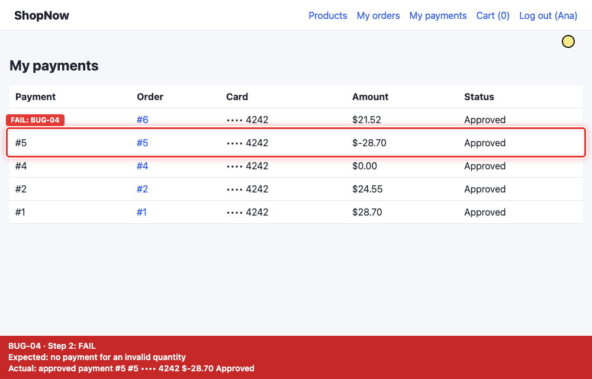
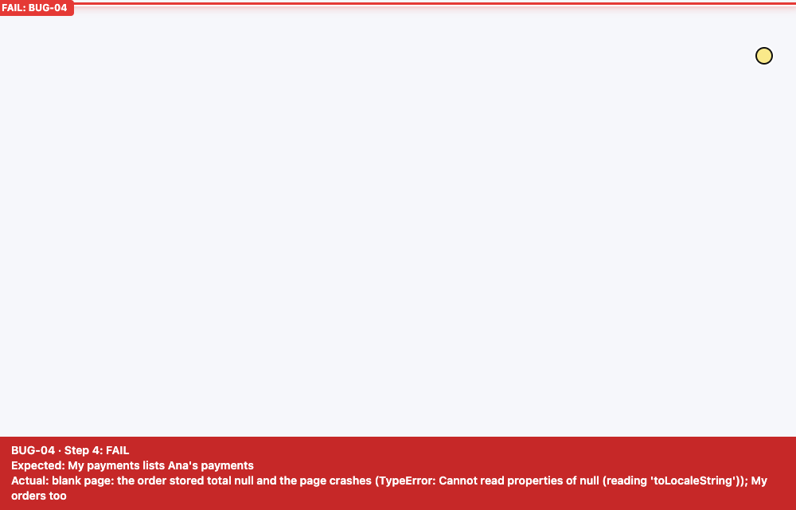

# BUG-04 — Checkout accepts zero, negative, decimal and non-numeric quantities

- **Environment:** ShopNow local (`npm run dev`) · app version: commit `29a3e61` · Chromium (Playwright 1.48.2) · timezone America/Argentina/Buenos_Aires · fresh data (`POST /api/test/reset`) · users ana@shopnow.test / bruno@shopnow.test · recorded 2026-11-13 15:45 UTC on http://localhost:4322 (port 4321 was in use on the recording machine; same app and data)
- **Resource:** [http://localhost:4321/api/checkout](http://localhost:4321/api/checkout)
- **Acceptance criteria:** AC-05, AC-14 (see docs/TRACEABILITY.md) · **Report:** [BUGS.md](../../BUGS.md) › BUG-04
- **Automated test:** `tests/checkout-validation.spec.ts (CHK-02…CHK-06)`

## Expected vs actual

- **Expected:** 400 for every mutant; no order, no payment, T-shirt stock stays 40
- **Actual:** 201 for all 4 mutants; -2 created an approved payment of -28.70; "abc" stored an order with total null that blanks My payments and My orders; T-shirt stock is now null

## What the user sees

### Step 1 — Ana opens My payments after quantities 0, -2 and 1.5

### Step 2 — Failure: expected vs actual

### Step 3 — Ana opens My payments after quantity "abc"

### Step 4 — Failure: expected vs actual

## HTTP log

| # | Request | Status | Request body | Response (first 300 chars) |
|---|---|---|---|---|
| 1 | `POST /api/login` | **200** | `{"email":"ana@shopnow.test","password":"Ana12345"}` | `{"id":1,"name":"Ana Garcia","email":"ana@shopnow.test"}` |
| 2 | `POST /api/checkout` | **201** | `{"items":[{"productId":3,"quantity":0}],"coupons":[],"shipping":{"name":"Ana Garcia","address":"1234 Corrientes Ave"},"card":{"number":"4242424242424242"}}` | `{"id":4,"userId":1,"createdAt":"2026-11-13T15:45:46.468Z","items":[{"productId":3,"name":"Basic T-shirt","price":14.35,"quantity":0}],"coupons":[],"subtotal":0,"discount":0,"total":0,"shipping":{"name":"Ana Garcia","address":"1234 Corrientes Ave"},"paymentId":4,"displayDate":"11/13/2026","displayTim` |
| 3 | `POST /api/checkout` | **201** | `{"items":[{"productId":3,"quantity":-2}],"coupons":[],"shipping":{"name":"Ana Garcia","address":"1234 Corrientes Ave"},"card":{"number":"4242424242424242"}}` | `{"id":5,"userId":1,"createdAt":"2026-11-13T15:45:47.193Z","items":[{"productId":3,"name":"Basic T-shirt","price":14.35,"quantity":-2}],"coupons":[],"subtotal":-28.7,"discount":0,"total":-28.7,"shipping":{"name":"Ana Garcia","address":"1234 Corrientes Ave"},"paymentId":5,"displayDate":"11/13/2026","d` |
| 4 | `POST /api/checkout` | **201** | `{"items":[{"productId":3,"quantity":1.5}],"coupons":[],"shipping":{"name":"Ana Garcia","address":"1234 Corrientes Ave"},"card":{"number":"4242424242424242"}}` | `{"id":6,"userId":1,"createdAt":"2026-11-13T15:45:47.900Z","items":[{"productId":3,"name":"Basic T-shirt","price":14.35,"quantity":1.5}],"coupons":[],"subtotal":21.52,"discount":0,"total":21.52,"shipping":{"name":"Ana Garcia","address":"1234 Corrientes Ave"},"paymentId":6,"displayDate":"11/13/2026","` |
| 5 | `POST /api/checkout` | **201** | `{"items":[{"productId":3,"quantity":"abc"}],"coupons":[],"shipping":{"name":"Ana Garcia","address":"1234 Corrientes Ave"},"card":{"number":"4242424242424242"}}` | `{"id":7,"userId":1,"createdAt":"2026-11-13T15:45:51.964Z","items":[{"productId":3,"name":"Basic T-shirt","price":14.35,"quantity":null}],"coupons":[],"subtotal":null,"discount":0,"total":null,"shipping":{"name":"Ana Garcia","address":"1234 Corrientes Ave"},"paymentId":7,"displayDate":"11/13/2026","d` |
| 6 | `GET /api/products/3` | **200** |  | `{"id":3,"name":"Basic T-shirt","category":"Clothing","price":14.35,"stock":null,"description":"Combed cotton T-shirt, regular fit."}` |
