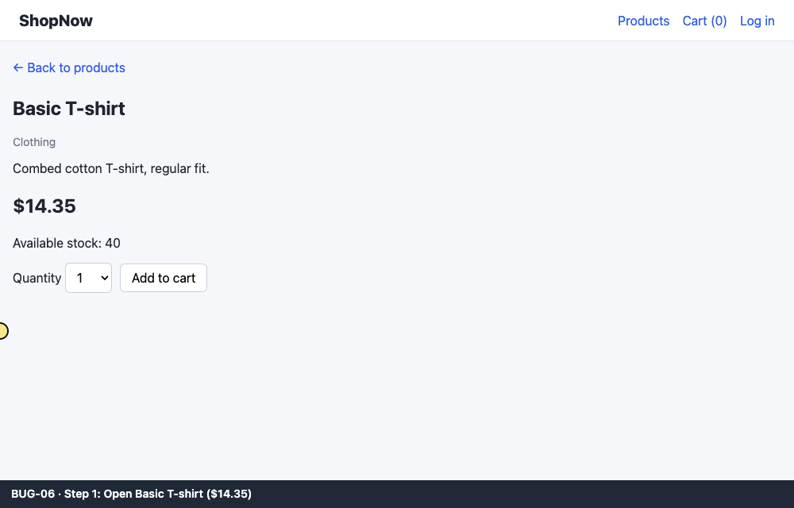
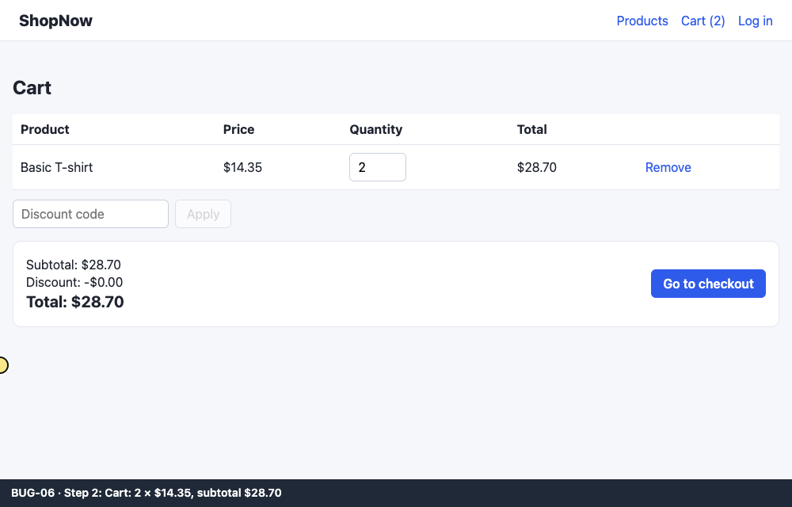
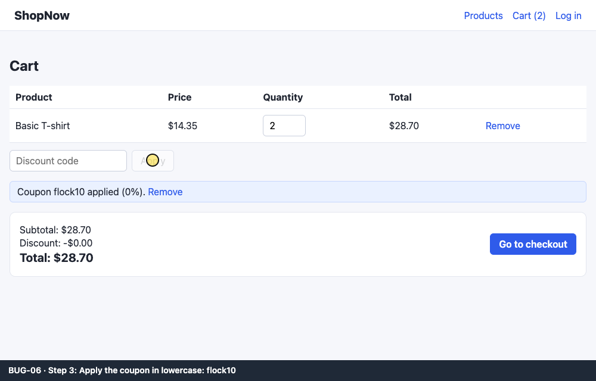
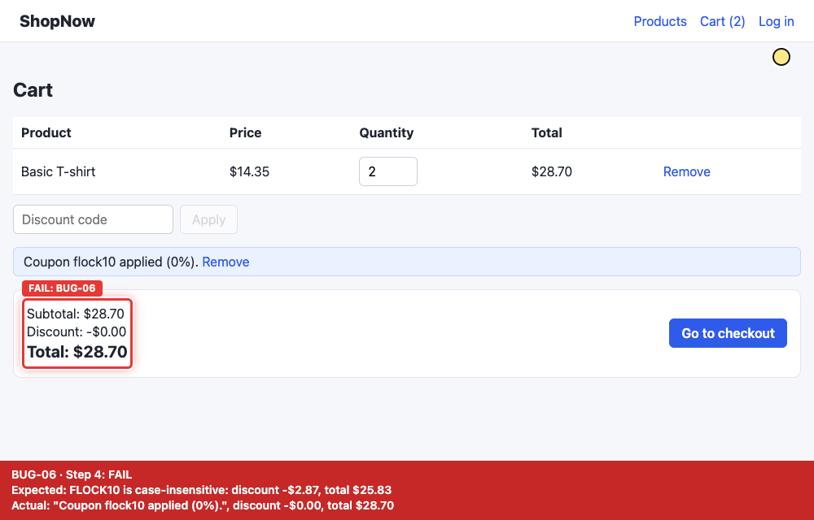

# BUG-06 — Lowercase coupon codes are accepted but give 0% discount

- **Environment:** ShopNow local (`npm run dev`) · app version: commit `29a3e61` · Chromium (Playwright 1.48.2) · timezone America/Argentina/Buenos_Aires · fresh data (`POST /api/test/reset`) · users ana@shopnow.test / bruno@shopnow.test · recorded 2026-11-13 15:36 UTC on http://localhost:4322 (port 4321 was in use on the recording machine; same app and data)
- **Resource:** [http://localhost:4321/cart](http://localhost:4321/cart)
- **Acceptance criteria:** AC-08, AC-09 (see docs/TRACEABILITY.md) · **Report:** [BUGS.md](../../BUGS.md) › BUG-06
- **Automated test:** `tests/coupons.spec.ts (CPN-01…CPN-05)`

## Expected vs actual

- **Expected:** FLOCK10 is case-insensitive: discount -$2.87, total $25.83
- **Actual:** "Coupon flock10 applied (0%).", discount -$0.00, total $28.70

## Video

Full quality: [BUG-06.mp4](BUG-06.mp4) (pointer visible, step banners, failure marked in red).

## Steps

### Step 1 — Open Basic T-shirt ($14.35)

### Step 2 — Cart: 2 × $14.35, subtotal $28.70

### Step 3 — Apply the coupon in lowercase: flock10

### Step 4 — Failure: expected vs actual

## HTTP log

| # | Request | Status | Request body | Response (first 300 chars) |
|---|---|---|---|---|
| 1 | `GET /api/products/3` | **200** |  | `{"id":3,"name":"Basic T-shirt","category":"Clothing","price":14.35,"stock":40,"description":"Combed cotton T-shirt, regular fit."}` |
| 2 | `GET /api/me` | **401** |  | `{"error":"Not logged in."}` |
| 3 | `GET /api/me` | **401** |  | `{"error":"Not logged in."}` |
| 4 | `POST /api/coupons/validate` | **200** | `{"code":"flock10"}` | `{"code":"flock10","percent":0}` |
