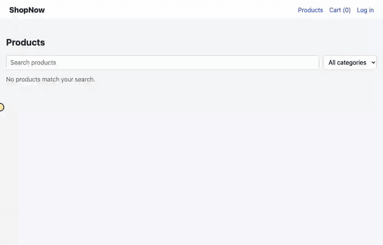
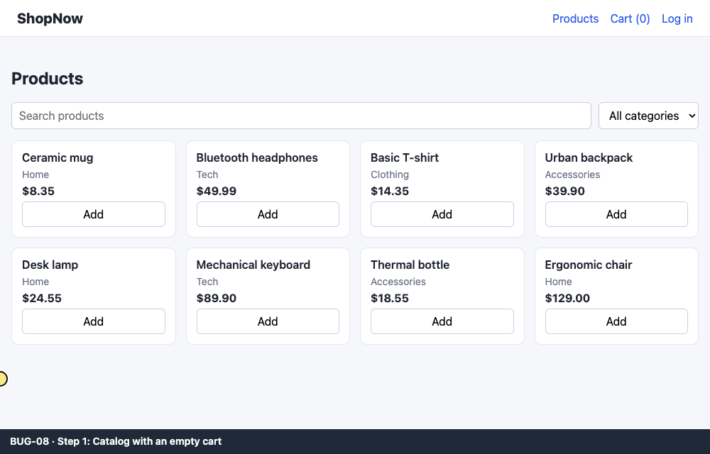
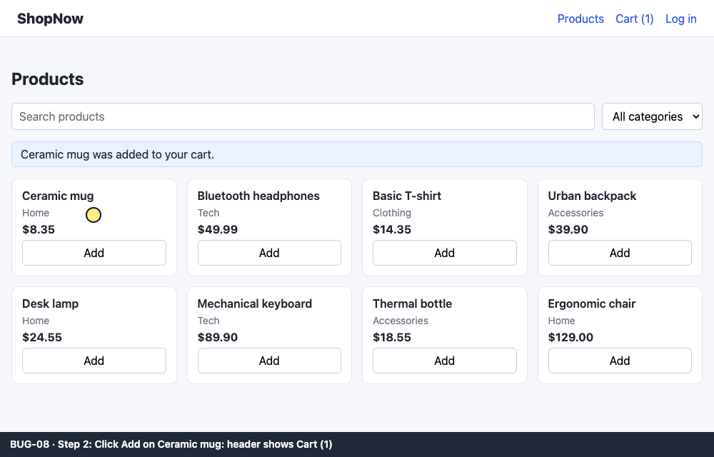
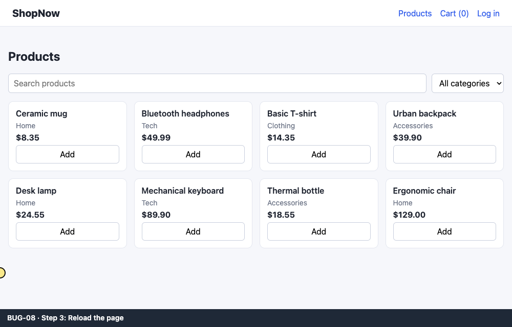
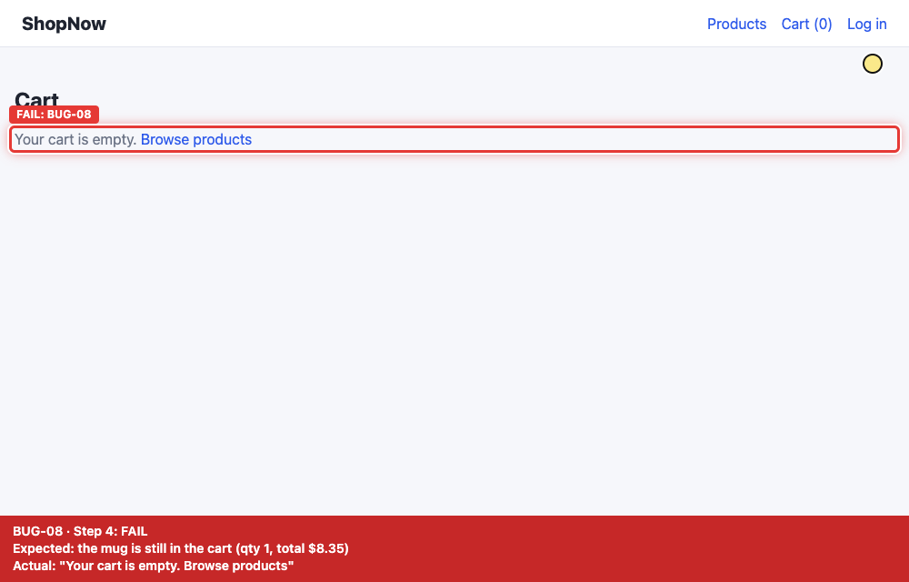

# BUG-08 — Products added with the catalog Add button vanish on reload

- **Environment:** ShopNow local (`npm run dev`) · app version: commit `29a3e61` · Chromium (Playwright 1.48.2) · timezone America/Argentina/Buenos_Aires · fresh data (`POST /api/test/reset`) · users ana@shopnow.test / bruno@shopnow.test · recorded 2026-11-13 15:37 UTC on http://localhost:4322 (port 4321 was in use on the recording machine; same app and data)
- **Resource:** [http://localhost:4321/](http://localhost:4321/)
- **Acceptance criteria:** AC-06, AC-02 (see docs/TRACEABILITY.md) · **Report:** [BUGS.md](../../BUGS.md) › BUG-08
- **Automated test:** `tests/cart.spec.ts (CART-02, CART-03)`

## Expected vs actual

- **Expected:** the mug is still in the cart (qty 1, total $8.35)
- **Actual:** "Your cart is empty. Browse products"

## Video

Full quality: [BUG-08.mp4](BUG-08.mp4) (pointer visible, step banners, failure marked in red).

## Steps

### Step 1 — Catalog with an empty cart

### Step 2 — Click Add on Ceramic mug: header shows Cart (1)

### Step 3 — Reload the page

### Step 4 — Failure: expected vs actual

## HTTP log

| # | Request | Status | Request body | Response (first 300 chars) |
|---|---|---|---|---|
| 1 | `GET /api/products?` | **200** |  | `[{"id":1,"name":"Ceramic mug","category":"Home","price":8.35,"stock":25,"description":"350 ml glazed ceramic mug. Microwave safe."},{"id":2,"name":"Bluetooth headphones","category":"Tech","price":49.99,"stock":3,"description":"Wireless headphones with 20 hours of battery and a charging case."},{"id"` |
| 2 | `GET /api/me` | **401** |  | `{"error":"Not logged in."}` |
| 3 | `GET /api/me` | **401** |  | `{"error":"Not logged in."}` |
| 4 | `GET /api/products?` | **200** |  | `[{"id":1,"name":"Ceramic mug","category":"Home","price":8.35,"stock":25,"description":"350 ml glazed ceramic mug. Microwave safe."},{"id":2,"name":"Bluetooth headphones","category":"Tech","price":49.99,"stock":3,"description":"Wireless headphones with 20 hours of battery and a charging case."},{"id"` |
