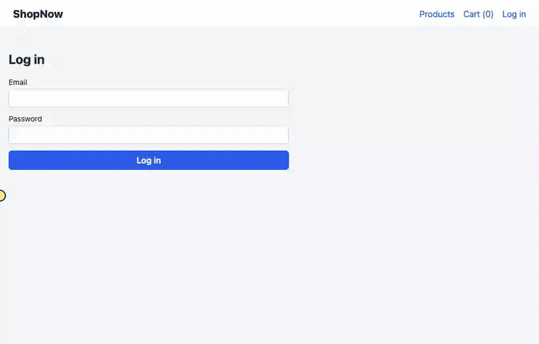
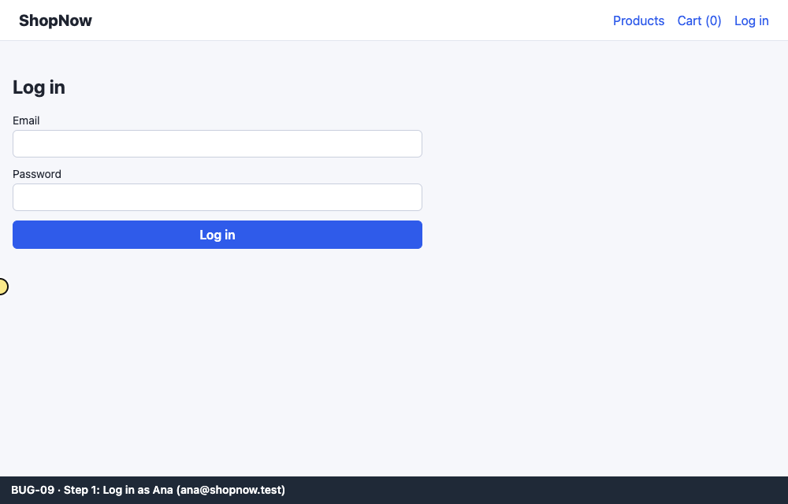
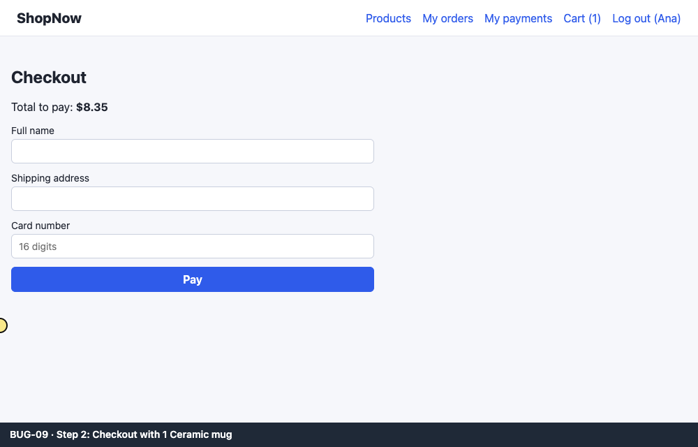
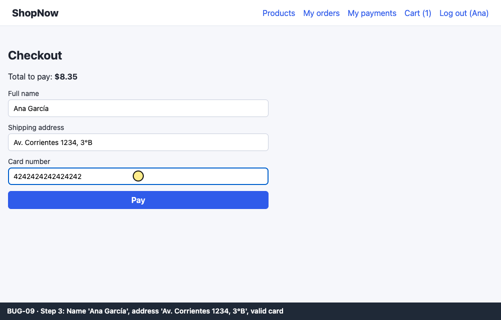
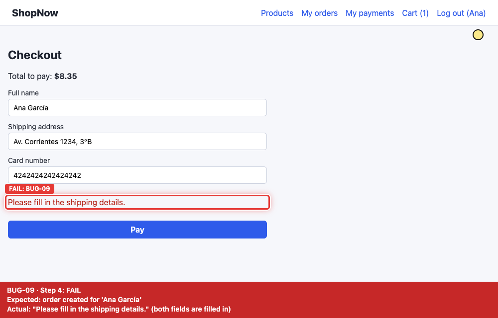

# BUG-09 — Names and addresses with accents, ñ, ° or apostrophes are rejected

- **Environment:** ShopNow local (`npm run dev`) · app version: commit `40bc732` · Chromium (Playwright 1.48.2) · timezone America/Argentina/Buenos_Aires · fresh data (`POST /api/test/reset`) · users ana@shopnow.test / bruno@shopnow.test · recorded 2026-11-13 15:37 UTC on http://localhost:4322 (port 4321 was in use on the recording machine; same app and data)
- **Resource:** [http://localhost:4321/checkout](http://localhost:4321/checkout)
- **Acceptance criteria:** AC-11 (see docs/TRACEABILITY.md) · **Report:** [BUGS.md](../../BUGS.md) › BUG-09
- **Automated test:** `tests/checkout-validation.spec.ts (CHK-07…CHK-09)`

## Expected vs actual

- **Expected:** order created for 'Ana García'
- **Actual:** "Please fill in the shipping details." (both fields are filled in)

## Video

Full quality: [BUG-09.mp4](BUG-09.mp4) (pointer visible, step banners, failure marked in red).

## Steps

### Step 1 — Log in as Ana (ana@shopnow.test)

### Step 2 — Checkout with 1 Ceramic mug

### Step 3 — Name 'Ana García', address 'Av. Corrientes 1234, 3°B', valid card

### Step 4 — Failure: expected vs actual

## HTTP log

| # | Request | Status | Request body | Response (first 300 chars) |
|---|---|---|---|---|
| 1 | `GET /api/me` | **401** |  | `{"error":"Not logged in."}` |
| 2 | `POST /api/login` | **200** | `{"email":"ana@shopnow.test","password":"Ana12345"}` | `{"id":1,"name":"Ana Garcia","email":"ana@shopnow.test"}` |
| 3 | `GET /api/products?` | **200** |  | `[{"id":1,"name":"Ceramic mug","category":"Home","price":8.35,"stock":25,"description":"350 ml glazed ceramic mug. Microwave safe."},{"id":2,"name":"Bluetooth headphones","category":"Tech","price":49.99,"stock":3,"description":"Wireless headphones with 20 hours of battery and a charging case."},{"id"` |
| 4 | `GET /api/products/1` | **200** |  | `{"id":1,"name":"Ceramic mug","category":"Home","price":8.35,"stock":25,"description":"350 ml glazed ceramic mug. Microwave safe."}` |
| 5 | `GET /api/me` | **200** |  | `{"id":1,"name":"Ana Garcia","email":"ana@shopnow.test"}` |
| 6 | `GET /api/me` | **200** |  | `{"id":1,"name":"Ana Garcia","email":"ana@shopnow.test"}` |
| 7 | `POST /api/checkout` | **400** | `{"items":[{"productId":1,"quantity":1}],"coupons":[],"shipping":{"name":"Ana García","address":"Av. Corrientes 1234, 3°B"},"card":{"number":"4242424242424242"}}` | `{"error":"Please fill in the shipping details."}` |
