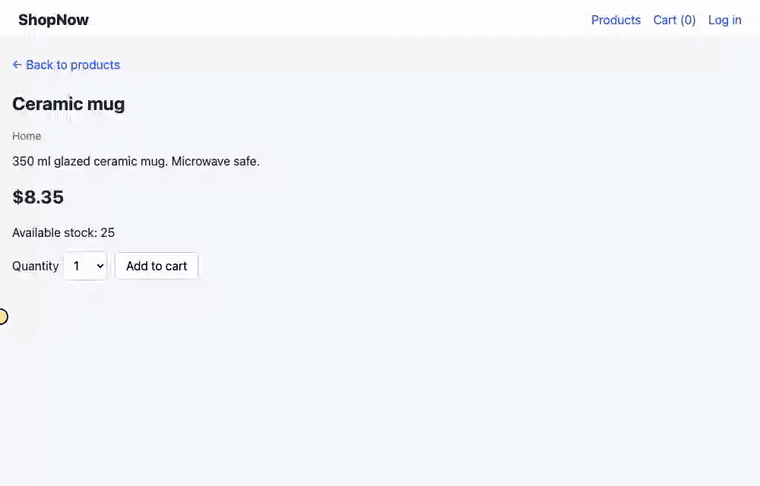
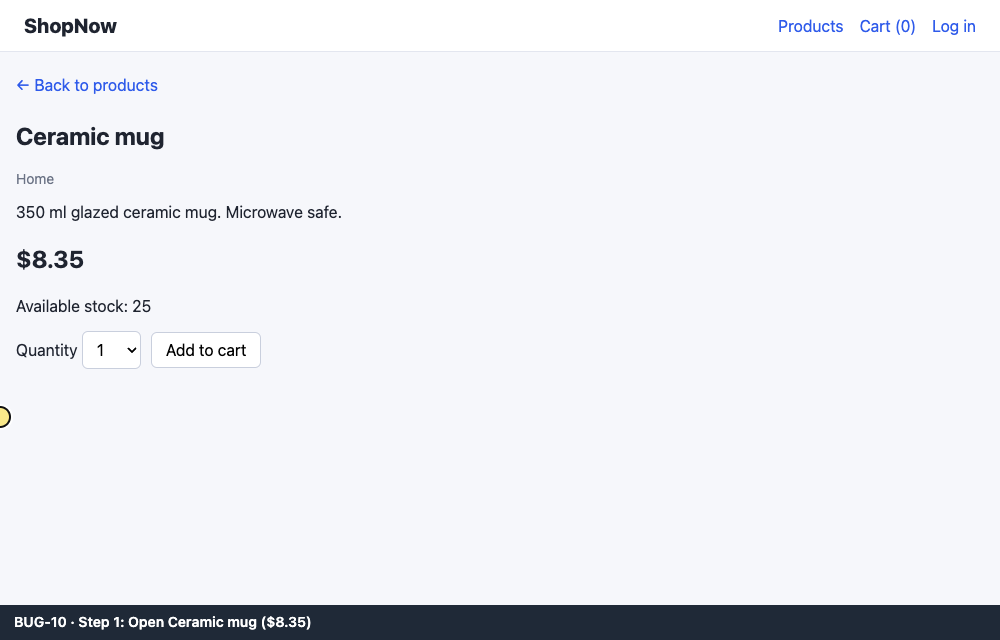
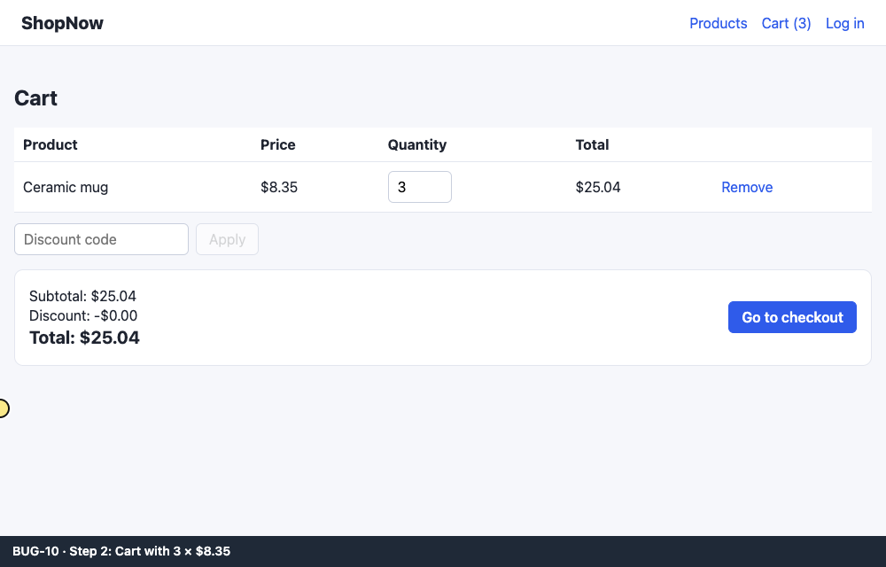
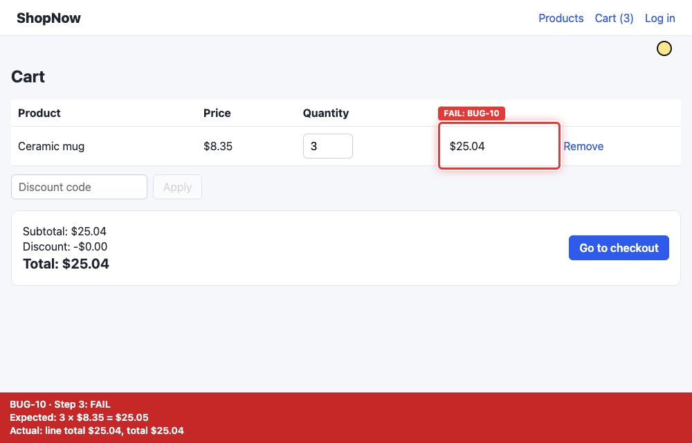

# BUG-10 — Line totals are truncated, so some amounts are one cent off

- **Environment:** ShopNow local (`npm run dev`) · app version: commit `40bc732` · Chromium (Playwright 1.48.2) · timezone America/Argentina/Buenos_Aires · fresh data (`POST /api/test/reset`) · users ana@shopnow.test / bruno@shopnow.test · recorded 2026-11-13 15:37 UTC on http://localhost:4322 (port 4321 was in use on the recording machine; same app and data)
- **Resource:** [http://localhost:4321/cart](http://localhost:4321/cart)
- **Acceptance criteria:** AC-04 (see docs/TRACEABILITY.md) · **Report:** [BUGS.md](../../BUGS.md) › BUG-10
- **Automated test:** `tests/cart.spec.ts (CART-04…CART-07)`

## Expected vs actual

- **Expected:** 3 × $8.35 = $25.05
- **Actual:** line total $25.04, total $25.04

## Video

Full quality: [BUG-10.mp4](BUG-10.mp4) (pointer visible, step banners, failure marked in red).

## Steps

### Step 1 — Open Ceramic mug ($8.35)

### Step 2 — Cart with 3 × $8.35

### Step 3 — Failure: expected vs actual

## HTTP log

| # | Request | Status | Request body | Response (first 300 chars) |
|---|---|---|---|---|
| 1 | `GET /api/products/1` | **200** |  | `{"id":1,"name":"Ceramic mug","category":"Home","price":8.35,"stock":25,"description":"350 ml glazed ceramic mug. Microwave safe."}` |
| 2 | `GET /api/me` | **401** |  | `{"error":"Not logged in."}` |
| 3 | `GET /api/me` | **401** |  | `{"error":"Not logged in."}` |
