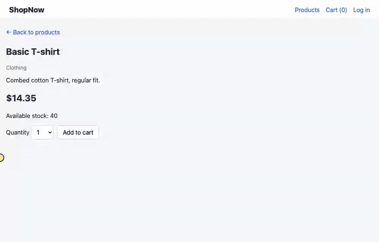
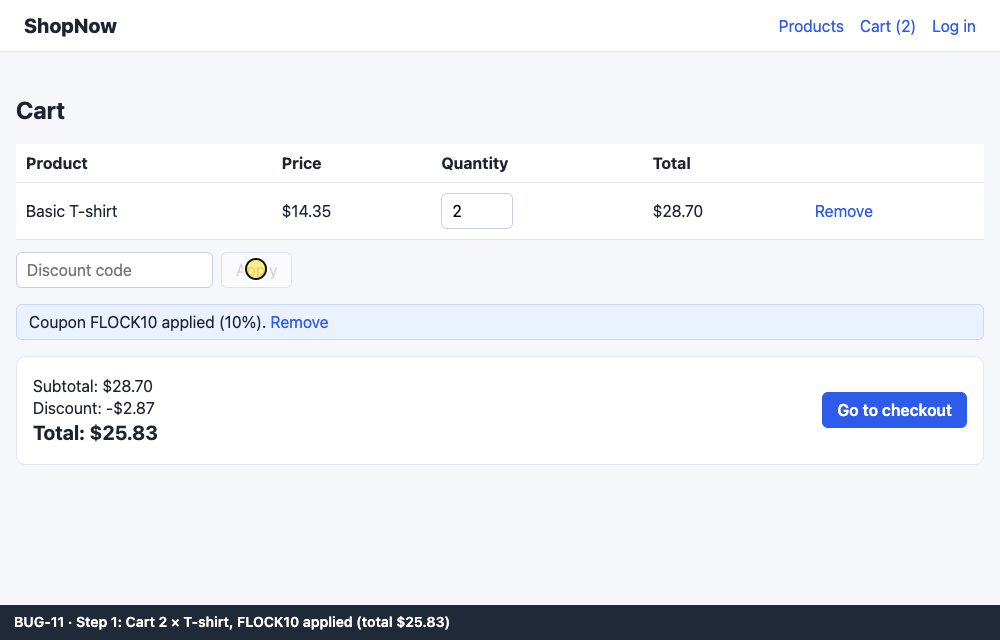
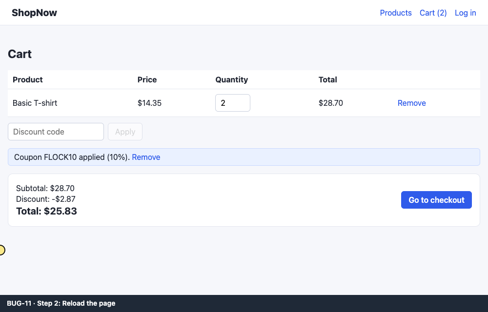
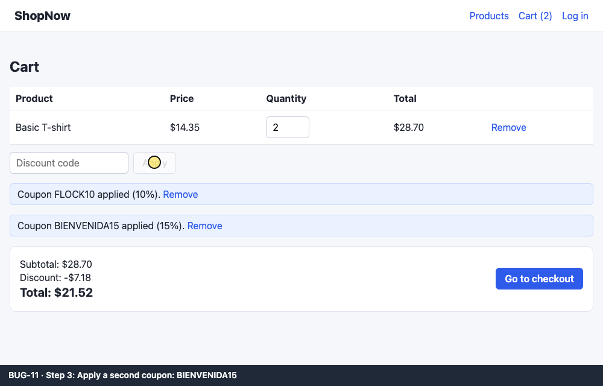
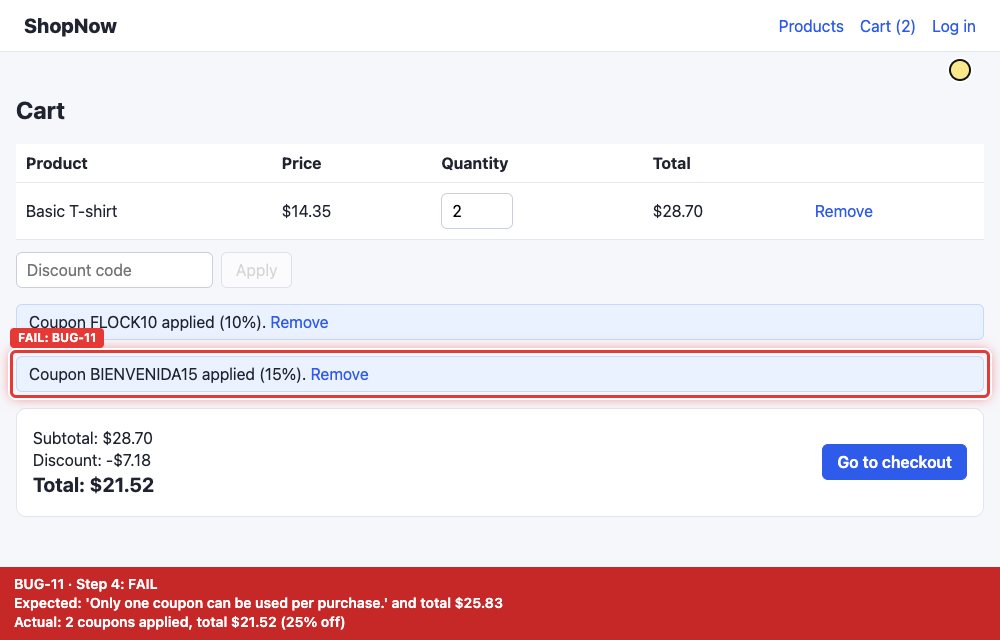

# BUG-11 — After a reload the cart lets the user stack a second coupon

- **Environment:** ShopNow local (`npm run dev`) · app version: commit `29a3e61` · Chromium (Playwright 1.48.2) · timezone America/Argentina/Buenos_Aires · fresh data (`POST /api/test/reset`) · users ana@shopnow.test / bruno@shopnow.test · recorded 2026-11-13 15:37 UTC on http://localhost:4322 (port 4321 was in use on the recording machine; same app and data)
- **Resource:** [http://localhost:4321/cart](http://localhost:4321/cart)
- **Acceptance criteria:** AC-07 (see docs/TRACEABILITY.md) · **Report:** [BUGS.md](../../BUGS.md) › BUG-11
- **Automated test:** `tests/coupons.spec.ts (CPN-09)`

## Expected vs actual

- **Expected:** 'Only one coupon can be used per purchase.' and total $25.83
- **Actual:** 2 coupons applied, total $21.52 (25% off)

## Video

Full quality: [BUG-11.mp4](BUG-11.mp4) (pointer visible, step banners, failure marked in red).

## Steps

### Step 1 — Cart 2 × T-shirt, FLOCK10 applied (total $25.83)

### Step 2 — Reload the page

### Step 3 — Apply a second coupon: BIENVENIDA15

### Step 4 — Failure: expected vs actual

## HTTP log

| # | Request | Status | Request body | Response (first 300 chars) |
|---|---|---|---|---|
| 1 | `GET /api/products/3` | **200** |  | `{"id":3,"name":"Basic T-shirt","category":"Clothing","price":14.35,"stock":40,"description":"Combed cotton T-shirt, regular fit."}` |
| 2 | `GET /api/me` | **401** |  | `{"error":"Not logged in."}` |
| 3 | `GET /api/me` | **401** |  | `{"error":"Not logged in."}` |
| 4 | `POST /api/coupons/validate` | **200** | `{"code":"FLOCK10"}` | `{"code":"FLOCK10","percent":10}` |
| 5 | `GET /api/me` | **401** |  | `{"error":"Not logged in."}` |
| 6 | `POST /api/coupons/validate` | **200** | `{"code":"BIENVENIDA15"}` | `{"code":"BIENVENIDA15","percent":15}` |
