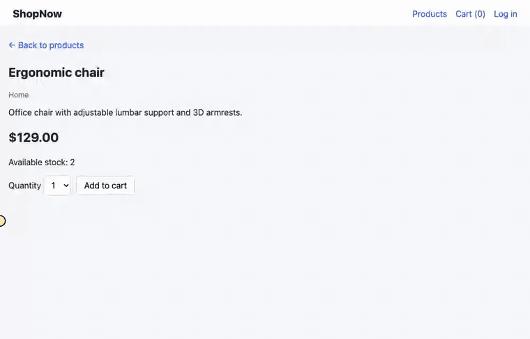
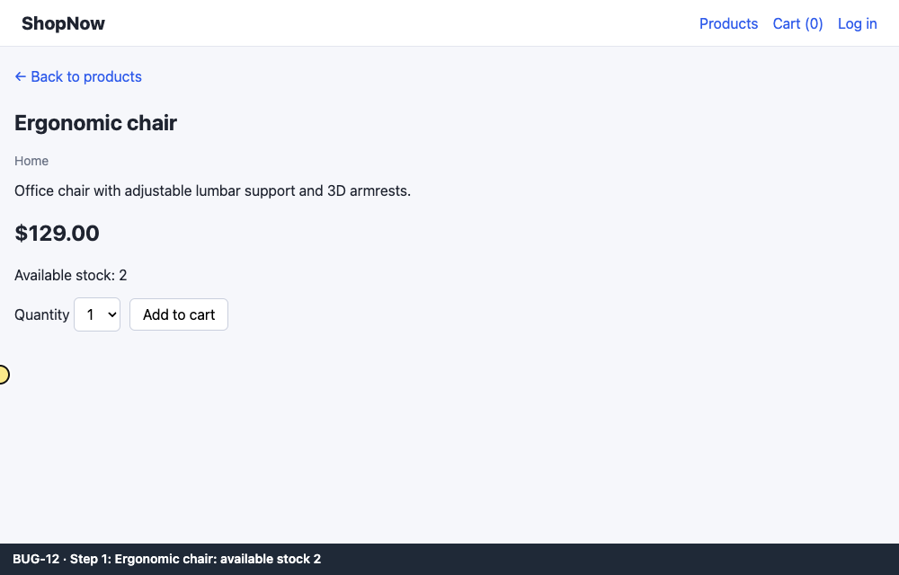
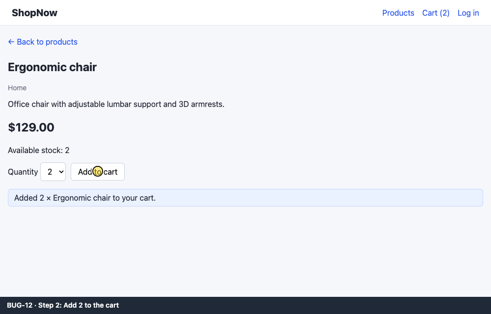
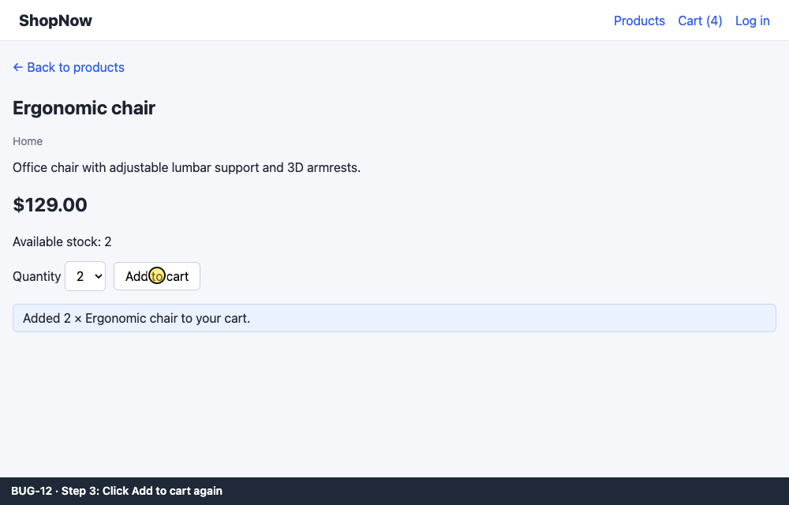
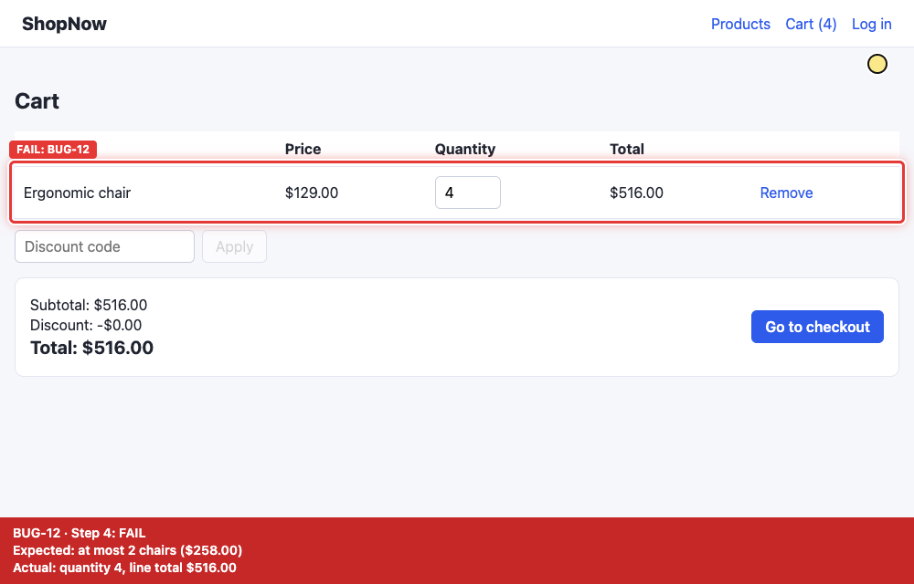

# BUG-12 — Adding a product twice from its page puts more than the stock in the cart

- **Environment:** ShopNow local (`npm run dev`) · app version: commit `29a3e61` · Chromium (Playwright 1.48.2) · timezone America/Argentina/Buenos_Aires · fresh data (`POST /api/test/reset`) · users ana@shopnow.test / bruno@shopnow.test · recorded 2026-11-13 15:37 UTC on http://localhost:4322 (port 4321 was in use on the recording machine; same app and data)
- **Resource:** [http://localhost:4321/product/8](http://localhost:4321/product/8)
- **Acceptance criteria:** AC-03 (see docs/TRACEABILITY.md) · **Report:** [BUGS.md](../../BUGS.md) › BUG-12
- **Automated test:** `tests/stock.spec.ts (STK-03)`

## Expected vs actual

- **Expected:** at most 2 chairs ($258.00)
- **Actual:** quantity 4, line total $516.00

## Video

Full quality: [BUG-12.mp4](BUG-12.mp4) (pointer visible, step banners, failure marked in red).

## Steps

### Step 1 — Ergonomic chair: available stock 2

### Step 2 — Add 2 to the cart

### Step 3 — Click Add to cart again

### Step 4 — Failure: expected vs actual

## HTTP log

| # | Request | Status | Request body | Response (first 300 chars) |
|---|---|---|---|---|
| 1 | `GET /api/products/8` | **200** |  | `{"id":8,"name":"Ergonomic chair","category":"Home","price":129,"stock":2,"description":"Office chair with adjustable lumbar support and 3D armrests."}` |
| 2 | `GET /api/me` | **401** |  | `{"error":"Not logged in."}` |
| 3 | `GET /api/me` | **401** |  | `{"error":"Not logged in."}` |
